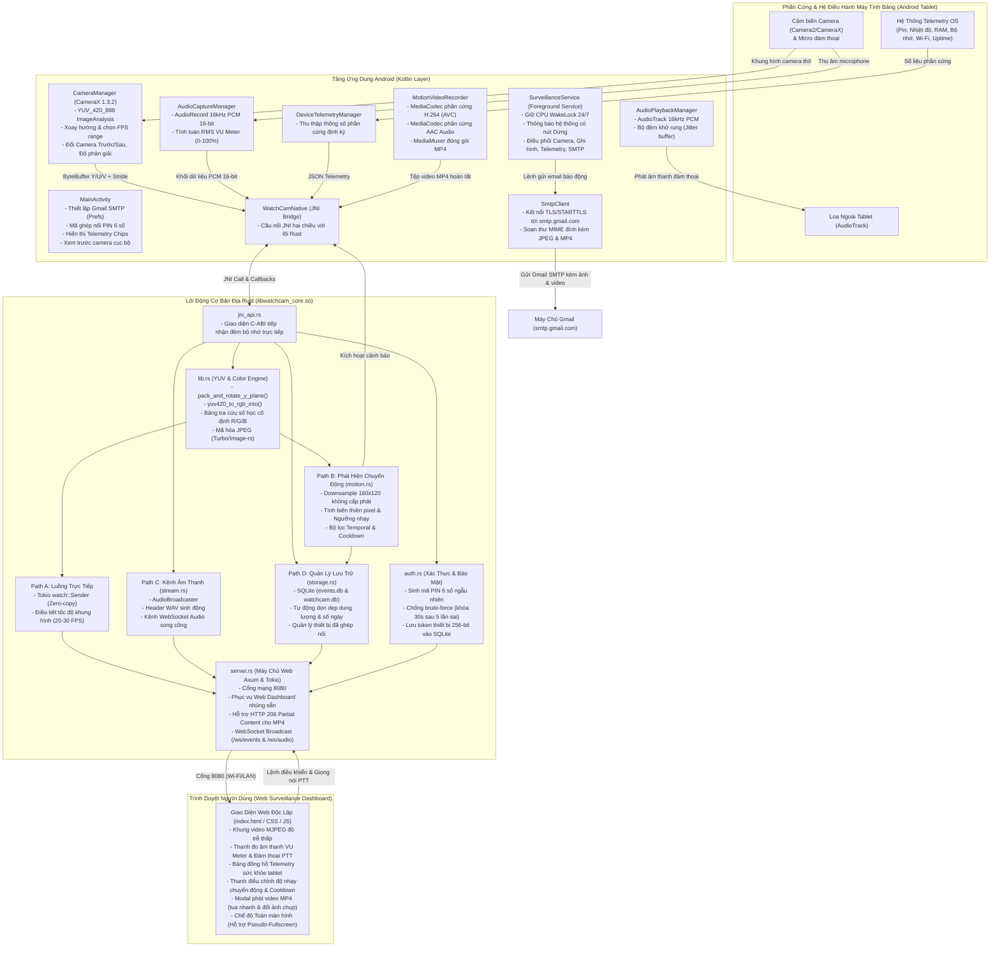
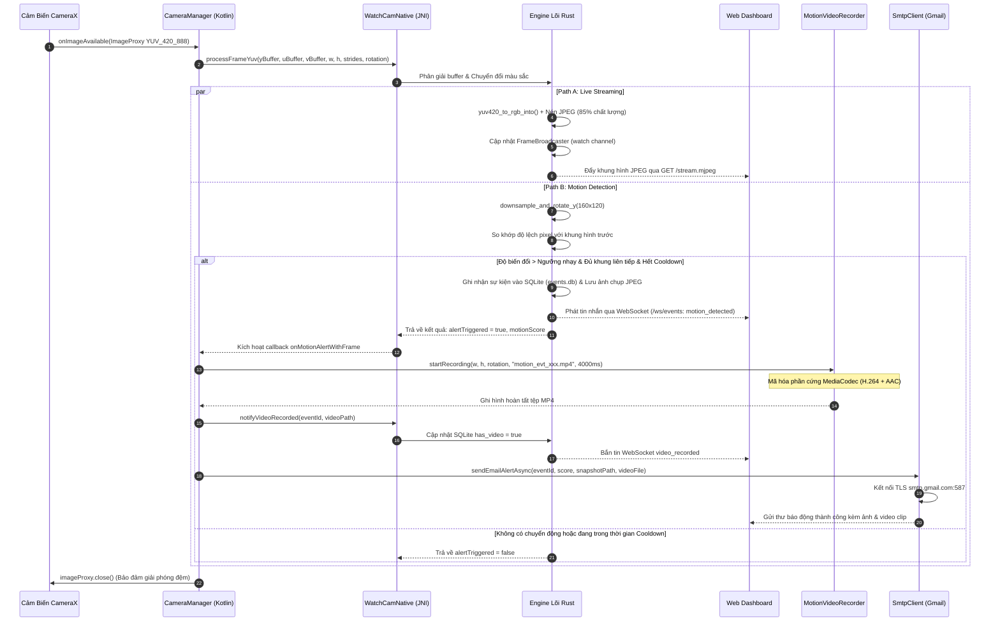
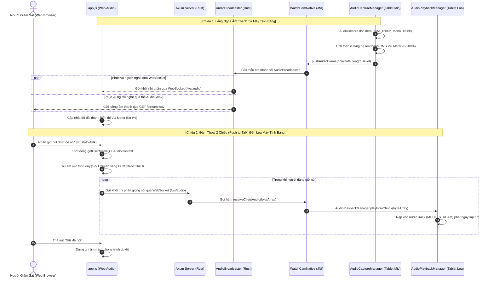
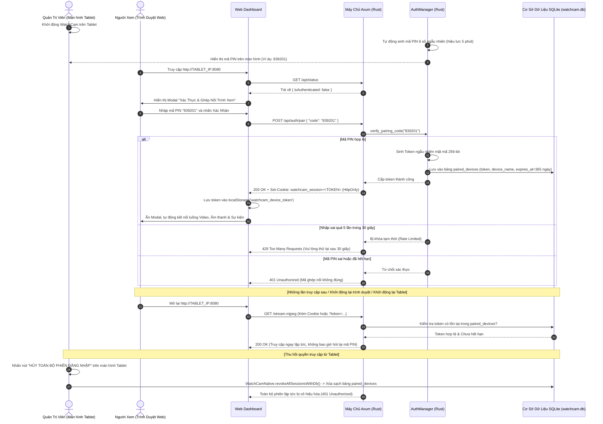

# WatchCam — Hệ Thống Giám Sát An Ninh Tự Lưu Trữ Cho Android

[](https://developer.android.com)
[](https://www.rust-lang.org)
[](https://developer.android.com/training/camerax)
[]()
[]()
[](LICENSE)

**WatchCam** là giải pháp phần mềm giám sát an ninh camera IP cục bộ (Local / Self-hosted Surveillance System) chuyên dụng, được thiết kế để tái sử dụng và chuyển đổi những chiếc máy tính bảng Android cũ hoặc giá rẻ (đặc biệt tối ưu hóa chuyên sâu cho dòng phần cứng **IvyPad Smart 5**, Android 11 / API 30, kiến trúc ARMv7 / ARM64 với 2 GB RAM) thành một camera giám sát an ninh thông minh, vận hành bền bỉ 24/7.

Hệ thống hoạt động **hoàn toàn khép kín trong mạng nội bộ (Wi-Fi / LAN)**: không yêu cầu kết nối đám mây (cloudless), không cần máy chủ trung gian, không thu phí thuê bao và loại trừ triệt để nguy cơ lộ lọt dữ liệu riêng tư ra ngoài Internet. WatchCam tích hợp một **Core Engine viết bằng ngôn ngữ Rust (`libwatchcam_core.so`)** có hiệu năng siêu cao, đảm nhiệm toàn bộ tác vụ xử lý ảnh màu YUV, thuật toán phát hiện chuyển động, mã hóa JPEG, quản lý cơ sở dữ liệu SQLite, máy chủ web Axum bất đồng bộ đa luồng trên nền Tokio, luồng âm thanh hai chiều (Intercom) và bảng điều khiển giám sát Web Dashboard tương thích mọi thiết bị máy tính và điện thoại.

---

## Mục lục

1. [Tổng Quan Dự Án & Các Tính Năng Cốt Lõi](#1-tổng-quan-dự-án--các-tính-năng-cốt-lõi)
2. [Cẩm Nang Nhập Môn & Cơ Chế Vận Hành Chi Tiết Cho Lập Trình Viên Mới](#2-cẩm-nang-nhập-môn--cơ-chế-vận-hành-chi-tiết-cho-lập-trình-viên-mới-developer-onboarding--internal-architecture-deep-dive)
   - [2.1 Mô Hình Tư Duy (Mental Model) & Triết Lý Phân Công Lao Động](#21-mô-hình-tư-duy-mental-model--triết-lý-phân-công-lao-động)
   - [2.2 Cơ Chế Zero-Copy JNI Buffer Passing (Bí Quyết Đạt 30 FPS)](#22-cơ-chế-zero-copy-jni-buffer-passing-bí-quyết-đạt-30-fps-trên-ram-2-gb)
   - [2.3 Vòng Lặp Biên Dịch Web Assets (Cạm Bẫy Lớn Nhất Của Người Mới)](#23-vòng-lặp-biên-dịch-web-assets-cạm-bẫy-lớn-nhất-của-người-mới)
   - [2.4 Tại Sao Rust Phát Hiện Chuyển Động Nhưng Android Lại Quay Video MP4?](#24-tại-sao-rust-phát-hiện-chuyển-động-nhưng-android-lại-quay-video-mp4)
   - [2.5 Cơ Chế Âm Thanh Hai Chiều Song Công (Full-Duplex Intercom)](#25-cơ-chế-âm-thanh-hai-chiều-song-công-full-duplex-intercom)
   - [2.6 Cẩm Nang Mở Rộng Tính Năng Từng Bước (Developer Playbook)](#26-cẩm-nang-mở-rộng-tính-năng-từng-bước-developer-playbook)
   - [2.7 Quy Chuẩn An Toàn Luồng & Cẩm Nang Gỡ Lỗi (Debugging Playbook)](#27-quy-chuẩn-an-toàn-luồng--cẩm-nang-gỡ-lỗi-debugging-playbook)
   - [2.8 Các Quy Tắc Bắt Buộc Khi Phát Triển Dự Án (Golden Rules)](#28-các-quy-tắc-bắt-buộc-khi-phát-triển-dự-án-golden-rules)
3. [Sơ Đồ Kiến Trúc Hệ Thống & Luồng Dữ Liệu Toàn Diện](#3-sơ-đồ-kiến-trúc-hệ-thống--luồng-dữ-liệu-toàn-diện)
   - [3.1 Sơ đồ tổng thể toàn bộ hệ thống (System Architecture Flowchart)](#31-sơ-đồ-tổng-thể-toàn-bộ-hệ-thống-system-architecture-flowchart)
   - [3.2 Sơ đồ luồng xử lý video & phát hiện chuyển động (Video & Motion Sequence)](#32-sơ-đồ-luồng-xử-lý-video--phát-hiện-chuyển-động-video--motion-sequence)
   - [3.3 Sơ đồ âm thanh & Đàm thoại 2 chiều (Two-Way Intercom Sequence)](#33-sơ-đồ-âm-thanh--đàm-thoại-2-chiều-two-way-intercom-sequence)
   - [3.4 Sơ đồ bảo mật & Ghi nhớ thiết bị ghép nối (Persistent Pairing Sequence)](#34-sơ-đồ-bảo-mật--ghi-nhớ-thiết-bị-ghép-nối-persistent-pairing-sequence)
4. [Lịch Sử Tiến Hóa Chi Tiết Của Dự Án](#4-lịch-sử-tiến-hóa-chi-tiết-của-dự-án)
   - [Mốc 1: Khởi dựng Nền móng & Bản dựng Đầu tiên (Foundation & Initial Build)](#mốc-1-khởi-dựng-nền-móng--bản-dựng-đầu-tiên-foundation--initial-build)
   - [Mốc 2: Tối ưu Chất lượng Luồng, Độ Chuẩn Màu Sắc & Nâng FPS](#mốc-2-tối-ưu-chất-lượng-luồng-độ-chuẩn-màu-sắc--nâng-fps)
   - [Mốc 3: Phát hiện Chuyển động Native & Cảnh báo Gmail SMTP](#mốc-3-phát-hiện-chuyển-động-native--cảnh-báo-gmail-smtp)
   - [Mốc 4: Thu thập & Hiển thị Dữ liệu Phần cứng Máy tính bảng (Hardware Health Telemetry)](#mốc-4-thu-thập--hiển-thị-dữ-liệu-phần-cứng-máy-tính-bảng-hardware-health-telemetry)
   - [Mốc 5: Chế độ Toàn màn hình Linh hoạt trên Thiết bị Di động (Mobile Fullscreen)](#mốc-5-chế-độ-toàn-màn-hình-linh-hoạt-trên-thiết-bị-di-động-mobile-fullscreen)
   - [Mốc 6: Ghi nhớ Thiết bị Ghép nối Vĩnh viễn (Persistent Device Pairing)](#mốc-6-ghi-nhớ-thiết-bị-ghép-nối-vĩnh-viễn-persistent-device-pairing)
   - [Mốc 7: Ghi hình Đoạn Video Clip Khi Có Chuyển động & Trình Xem Video Web](#mốc-7-ghi-hình-đoạn-video-clip-khi-có-chuyển-động--trình-xem-video-web)
   - [Mốc 8: Chuyển dịch Cấu hình Gmail SMTP sang Ứng dụng Android](#mốc-8-chuyển-dịch-cấu-hình-gmail-smtp-sang-ứng-dụng-android)
   - [Mốc 9: Truyền Âm thanh Trực tiếp & Đàm thoại 2 Chiều (Two-Way Intercom)](#mốc-9-truyền-âm-thanh-trực-tiếp--đàm-thoại-2-chiều-two-way-intercom)
   - [Mốc 10: Tối giản Hóa & Xóa Bỏ Toàn Bộ Biểu Tượng / Emoji (Minimalist Text-Only UI)](#mốc-10-tối-giản-hóa--xóa-bỏ-toàn-bộ-biểu-tượng--emoji-minimalist-text-only-ui)
   - [Mốc 11: Nâng Cấp Nhận Diện Thực Thể (Người, Vật Thể, Chuyển Động) & Đại Tu Hệ Thống Đàm Thoại 2 Chiều](#mốc-11-nâng-cấp-nhận-diện-thực-thể-người-vật-thể-chuyển-động--đại-tu-hệ-thống-đàm-thoại-2-chiều)
   - [Mốc 12: Hỗ Trợ Đàm Thoại 2 Chiều Trên Mạng Tailscale / Không Dùng Chung Mạng & Tích Hợp Native HTTPS / TLS Trong Rust Core](#mốc-12-hỗ-trợ-đàm-thoại-2-chiều-trên-mạng-tailscale--không-dùng-chung-mạng--tích-hợp-native-https--tls-trong-rust-core)
   - [Mốc 13: Tối Ưu Hóa Thuật Toán Nhận Diện Chuyển Động Siêu Mượt & Bền Vững (Spatial Clustering, Temporal EMA Smoothing, Global Lighting Shift Suppression, 60 FPS Web UI Interpolation & Smooth Fade-Out)](#mốc-13-tối-ưu-hóa-thuật-toán-nhận-diện-chuyển-động-siêu-mượt--bền-vững-spatial-clustering-temporal-ema-smoothing-global-lighting-shift-suppression-60-fps-web-ui-interpolation--smooth-fade-out)
   - [Mốc 14: Tối Ưu Hóa Nhận Diện Khi Quay Ngược Camera & Chuyển Đổi Không Gian Tọa Độ Hình Học (Coordinate Transformations & Rotation Optimization)](#47-tối-ưu-hóa-nhận-diện-khi-quay-ngược-camera--chuyển-đổi-không-gian-tọa-độ-hình-học)
   - [Mốc 15: Bảo Vệ Quyền Riêng Tư (Privacy Hardening) - Loại Bỏ Hoàn Toàn Hiển Thị Mạng Tailscale / VPN & Rà Soát Làm Sạch Thông Tin Bí Mật Cá Nhân](#mốc-15-bảo-vệ-quyền-riêng-tư-privacy-hardening---loại-bỏ-hoàn-toàn-hiển-thị-mạng-tailscale--vpn--rà-soát-làm-sạch-thông-tin-bí-mật-cá-nhân)
5. [Cấu Trúc Thư Mục & Bản Đồ Mã Nguồn (Codebase Map)](#5-cấu-trúc-thư-mục--bản-đồ-mã-nguồn-codebase-map)
6. [Thông Số Kỹ Thuật & Đặc Tả Giao Thức (Specifications)](#6-thông-số-kỹ-thuật--đặc-tả-giao-thức-specifications)
   - [6.1 Danh mục REST API Endpoints](#61-danh-mục-rest-api-endpoints)
   - [6.2 Đặc tả giao thức WebSocket](#62-đặc-tả-giao-thức-websocket)
   - [6.3 Giao diện Native JNI Bridge](#63-giao-diện-native-jni-bridge)
   - [6.4 Cấu trúc cơ sở dữ liệu SQLite](#64-cấu-trúc-cơ-sở-dữ-liệu-sqlite)
7. [Hướng Dẫn Biên Dịch, Triển Khai & Vận Hành (Build & Deployment)](#7-hướng-dẫn-biên-dịch-triển-khai--vận-hành-build--deployment)
8. [Giấy Phép & Bản Quyền](#8-giấy-phép--bản-quyền)

---

## 1. Tổng Quan Dự Án & Các Tính Năng Cốt Lõi

WatchCam giải quyết bài toán tái chế thiết bị phần cứng thông minh cũ bằng việc kết hợp sức mạnh phần cứng máy ảnh của Android với độ tin cậy và tốc độ thực thi của Rust:

- **100% Nội bộ & Không Đám mây (Zero Cloud Dependency):** Dữ liệu hình ảnh, video và sự kiện cảnh báo được xử lý và lưu trữ hoàn toàn trên bộ nhớ của máy tính bảng. Không yêu cầu tài khoản bên ngoài, không lo đứt cáp Internet hay bị theo dõi từ xa.
- **Kiến trúc Lai Android-Rust (Hybrid Architecture):** 
  - Tầng Android (Kotlin) quản lý vòng đời ứng dụng, phần cứng CameraX, microphone `AudioRecord`, loa ngoài `AudioTrack`, hệ thống thông báo tiền cảnh (Foreground Service) và giữ CPU luôn thức (Partial WakeLock).
  - Tầng Native (Rust `cdylib`) xử lý toàn bộ luồng video độ phân giải cao, chuyển đổi hệ màu YUV sang RGB bằng bảng tính cố định SIMD, xoay khung hình 4 hướng (0°, 90°, 180°, 270°), nén JPEG với độ nén cấu hình được, chạy thuật toán phát hiện chuyển động không cấp phát bộ nhớ động, đồng thời vận hành máy chủ HTTP Axum phục vụ hàng chục kết nối đồng thời mà mức chiếm dụng RAM chỉ duy trì quanh mức ~35-50 MB RSS, triệt tiêu hoàn toàn hiện tượng khựng khung hình do Garbage Collector (GC) của Java gây ra.
- **Bộ Chuyển Đổi Màu Sắc Chuẩn Xác & Nâng FPS:** Sửa triệt để lỗi đảo màu kinh điển của định dạng NV21/YUV420 trên Android (hiện tượng Blue/Red chroma swap), tái tạo màu sắc trung thực 100%, tốc độ truyền phát thực tế đạt từ 20 đến 30 FPS mượt mà.
- **Phát Hiện Chuyển Động Native Đa Tầng:**
  - Lấy mẫu trực tiếp kênh Y độ phân giải thấp (160×120) với chi phí CPU gần như bằng 0.
  - Phân tích độ sai lệch pixel tuyệt đối kết hợp ngưỡng nhạy điều chỉnh từ 10 đến 95.
  - Bộ lọc thời gian (temporal confirmation filter) yêu cầu sự biến đổi qua nhiều frame liên tiếp cùng cơ chế thời gian nghỉ (cooldown) linh hoạt nhằm loại bỏ hoàn toàn cảnh báo giả do ánh sáng chớp tắt hoặc nhiễu cảm biến ban đêm.
- **Ghi Đoạn Video Clip MP4 & Phát Lại Trên Trình Duyệt:** Khi phát hiện xâm nhập, hệ thống tự động ghi lại đoạn video 3-5 giây với chuẩn mã hóa phần cứng H.264 (AVC) kèm âm thanh chuẩn AAC đóng gói trong tệp `.mp4`. Máy chủ web hỗ trợ chuẩn HTTP 206 Partial Content (Range requests) cho phép xem lại trực tiếp trên Web Dashboard mà không cần tải hết tệp.
- **Gửi Cảnh Báo Gmail Đính Kèm Ảnh & Video:** Tích hợp bộ máy gửi email SMTP qua kết nối an toàn TLS (cổng 587) / SSL (cổng 465) tới máy chủ Google Gmail, tự động gửi thư báo động kèm theo cả ảnh chụp JPEG và clip video MP4 ngay khi xảy ra sự kiện.
- **Giám Sát Tình Trạng Phần Cứng Toàn Diện (Hardware Telemetry):** Cung cấp các thông số sức khỏe phần cứng trực tiếp theo chu kỳ 2 giây: Mức pin %, trạng thái sạc, nhiệt độ pin/máy, tỉ lệ RAM đã dùng, dung lượng ổ cứng còn trống, cường độ sóng Wi-Fi (dBm), tốc độ liên kết và thời gian máy hoạt động liên tục (Uptime).
- **Âm Thanh Trực Tiếp & Đàm Thoại 2 Chiều (Two-Way Intercom):**
  - Chiều nghe: Thu âm từ microphone máy tính bảng (16kHz PCM 16-bit), đo cường độ âm thanh thời gian thực (VU Meter bar) và phát trực tiếp tới trình duyệt qua `/stream.wav` hoặc WebSocket.
  - Chiều nói (Push-to-Talk): Người dùng nhấn giữ nút trên trình duyệt máy tính hoặc điện thoại để truyền giọng nói qua microphone, âm thanh truyền qua WebSocket xuống native engine và phát trực tiếp ra loa máy tính bảng bằng `AudioTrack`.
- **Ghi Nhớ Thiết Bị Ghép Nối Vĩnh Viễn (Persistent Pairing):** Sử dụng mã PIN 6 số hiển thị trên màn hình máy tính bảng để xác thực lần đầu; sau đó hệ thống tự động cấp phát token bảo mật 256-bit lưu vào cơ sở dữ liệu SQLite `watchcam.db`. Trình duyệt đã kết nối sẽ được ghi nhớ vĩnh viễn mà không bao giờ cần nhập lại mã, đi kèm nút thu hồi phiên đăng nhập tức thời trên tablet.
- **Chế Độ Toàn Màn Hình Hoàn Hảo Cho Di Động (Pseudo-Fullscreen Fallback):** Khắc phục lỗi hạn chế API Fullscreen trên các trình duyệt di động (iOS Safari, mobile Chrome/Firefox) bằng cơ chế toàn màn hình ảo CSS, hỗ trợ vuốt cử chỉ quay lại (Back gesture) của Android mà không thoát trang web.
- **Giao Diện Thuần Chữ Tinh Gọn (Minimalist Text-Based Design):** Loại bỏ toàn bộ icon đồ họa và biểu tượng emoji, mang lại diện mạo chuyên nghiệp, rõ ràng, đẳng cấp cho hệ thống an ninh giám sát.

---

## 2. Cẩm Nang Nhập Môn & Cơ Chế Vận Hành Chi Tiết Cho Lập Trình Viên Mới (Developer Onboarding & Internal Architecture Deep-Dive)

> [!NOTE]
> Mục này được biên soạn dành riêng cho các kỹ sư phần mềm, lập trình viên lần đầu tiếp cận mã nguồn WatchCam. Nó giải mã toàn bộ triết lý thiết kế, các quyết định kiến trúc quan trọng, cơ chế phối hợp giữa Android và Rust, cũng như các cạm bẫy kỹ thuật mà bạn cần nắm rõ trước khi bắt tay vào chỉnh sửa hoặc phát triển thêm tính năng.

### 2.1 Mô Hình Tư Duy (Mental Model) & Triết Lý Phân Công Lao Động

Khi mở dự án WatchCam lần đầu, bạn có thể tự hỏi: *Tại sao không viết toàn bộ bằng Kotlin thuần túy, hoặc dùng Flutter / React Native, hoặc viết hẳn một chương trình Linux C++ chạy trong Termux?*

Câu trả lời nằm ở bài toán phần cứng: **Máy tính bảng Android giá rẻ / đời cũ (tiêu biểu là IvyPad Smart 5 với chip MediaTek/Spreadtrum 4 nhân, RAM 2 GB)**.
- Nếu viết bằng Java/Kotlin thuần túy: Bộ gom rác của máy ảo Java (JVM Garbage Collector) sẽ liên tục phải dọn dẹp hàng triệu đối tượng ảnh và đệm âm thanh sinh ra mỗi giây. Cứ mỗi vài giây, GC sẽ gây khựng toàn bộ ứng dụng (Stop-the-World pauses), khiến luồng video giật lag và CPU bị quá tải nhiệt dẫn đến phồng pin hoặc bị Android giải phóng tiến trình (kill process).
- Nếu chỉ chạy C/C++ thuần túy qua dòng lệnh Linux: Bạn sẽ mất quyền truy cập vào các API camera hiện đại (CameraX), bộ mã hóa video phần cứng (MediaCodec ASIC), hệ thống dịch vụ tiền cảnh (Foreground Service) và trình quản lý nguồn điện (PowerManager WakeLock) vốn được Android bảo vệ chặt chẽ.

**Do đó, WatchCam áp dụng mô hình phân chia trách nhiệm tối ưu:**
- **Tầng Android Kotlin (`app/`) đảm nhiệm vai trò Quản lý Vòng đời & Tương tác Phần cứng OS:**
  - Xin các quyền nhạy cảm từ người dùng (`CAMERA`, `RECORD_AUDIO`, `POST_NOTIFICATIONS`).
  - Khởi động dịch vụ tiền cảnh `SurveillanceService` gắn thông báo thường trực và giữ `PARTIAL_WAKE_LOCK` để CPU không bị rơi vào trạng thái ngủ sâu (Deep Sleep) khi tắt màn hình.
  - Cấu hình CameraX `ImageAnalysis` để nhận luồng khung hình từ cảm biến camera.
  - Cấu hình `AudioRecord` (thu âm) và `AudioTrack` (phát âm thanh đàm thoại).
  - Tận dụng bộ mã hóa phần cứng `MediaCodec` để nén video H.264 và âm thanh AAC ra tệp `.mp4` với mức tiêu thụ CPU gần như bằng 0.
  - Thu thập thông số phần cứng (pin, nhiệt độ, RAM, Wi-Fi) qua các BroadcastReceiver của Android.
- **Tầng Native Rust (`rust_core/`) đảm nhiệm vai trò Bộ Não Xử Lý & Máy Chủ Đa Luồng:**
  - Tiếp nhận con trỏ bộ nhớ khung hình camera thô từ Android qua JNI mà không sao chép dữ liệu (Zero-Copy).
  - Chuyển đổi định dạng màu sắc YUV420 sang RGB bằng bảng tính số học cố định (SIMD Lookup Tables), đồng thời xoay ảnh 4 hướng mà không cấp phát thêm ô nhớ động nào trong heap.
  - Nén ảnh JPEG phục vụ luồng phát trực tiếp `/stream.mjpeg`.
  - Chạy thuật toán phát hiện chuyển động không cấp phát bộ nhớ (Downsample kênh Y về 160x120 kết hợp bộ lọc thời gian và thời gian nghỉ cooldown).
  - Vận hành máy chủ HTTP/WebSocket bất đồng bộ cực nhẹ trên nền tảng Tokio và Axum (lắng nghe cổng 8080).
  - Quản lý cơ sở dữ liệu SQLite `watchcam.db` lưu trữ sự kiện và ghi nhớ thiết bị đã ghép nối an toàn.
  - Điều phối luồng âm thanh hai chiều giữa microphone máy tính bảng và loa ngoài qua WebSocket.

---

### 2.2 Cơ Chế Zero-Copy JNI Buffer Passing (Bí Quyết Đạt 30 FPS Trên RAM 2 GB)

Ranh giới giữa Java/Kotlin và Native C/Rust (JNI Boundary) là nơi dễ xảy ra nghẽn cổ chai nhất trong các ứng dụng xử lý ảnh:

1. **Sai lầm truyền thống cần tránh:**
   Thông thường, người ta hay gọi `image.planes[0].buffer.get(byteArray)` ở tầng Java rồi truyền mảng `byteArray` xuống C/Rust. Thao tác này buộc JVM phải cấp phát một mảng byte mới trong heap và sao chép từng byte từ bộ nhớ phần cứng vào mảng đó. Với độ phân giải 720p hoặc 480p ở tốc độ 30 FPS, thao tác này ngốn từ 20 đến 50 MB RAM/giây, khiến GC chạy liên tục và làm tụt FPS xuống dưới 10!

2. **Cách WatchCam xử lý (Zero-Copy Architecture):**
   - Trong `CameraManager.kt`, CameraX trả về đối tượng `ImageProxy` với 3 mặt phẳng Y, U, V dạng `Direct ByteBuffer`. Direct ở đây nghĩa là vùng đệm này nằm trực tiếp trong bộ nhớ chia sẻ của driver máy ảnh, nằm ngoài tầm kiểm soát của Java Garbage Collector.
   - Kotlin chỉ trích xuất các thuộc tính hình học: `width`, `height`, `yRowStride`, `uRowStride`, `vRowStride`, `uPixelStride`, `vPixelStride`, `rotationDegrees` và truyền trực tiếp 3 đối tượng `Direct ByteBuffer` xuống hàm JNI:
     ```kotlin
     WatchCamNative.processFrameYuv(yBuf, uBuf, vBuf, width, height, yRowStride, uRowStride, vRowStride, uPixStride, vPixStride, rotation)
     ```
   - Trong `rust_core/src/jni_api.rs`, Rust gọi hàm `env.get_direct_buffer_address(y_buf)` để lấy con trỏ thô `*mut u8` trỏ thẳng tới ô nhớ phần cứng và bọc nó trong một Rust slice an toàn:
     ```rust
     let y_slice = std::slice::from_raw_parts(y_ptr, y_len);
     ```
   - Thời gian truyền dữ liệu giữa Android và Rust thực tế là **0 mili-giây** (chỉ truyền con trỏ 64-bit hoặc 32-bit, không có bất kỳ byte hình ảnh nào bị sao chép).

3. **Cơ chế truyền cờ điều khiển ngược qua mảng FloatArray 12 phần tử:**
   Thay vì phải dùng JNI callback từ Rust gọi ngược lại các phương thức của Java (vốn rất chậm và dễ gây deadlock), hàm `processFrameYuv()` trả về ngay một mảng số thực `FloatArray(12)` chứa đầy đủ kết quả tính toán, nhận diện thực thể và mệnh lệnh từ Rust gửi lên Kotlin:
   - Phần tử `[0]`: `1.0f` nếu phát hiện chuyển động vượt ngưỡng cần báo động; `0.0f` nếu an toàn.
   - Phần tử `[1]`: Điểm số chuyển động thực tế (Motion Score từ `0.0` đến `1.0`).
   - Phần tử `[2]`: `1.0f` nếu người dùng trên Web bấm nút yêu cầu đổi camera trước/sau.
   - Phần tử `[3]`: Trạng thái bật/tắt giám sát hệ thống (`1.0f` = Bật, `0.0f` = Tạm dừng).
   - Phần tử `[4]`: Mã thay đổi độ phân giải (`0` = Giữ nguyên, `1` = Chuyển về 480p, `2` = Chuyển lên 720p).
   - Phần tử `[5]`: `1.0f` nếu người dùng trên Web bấm nút yêu cầu gửi email kiểm tra kết nối Gmail SMTP.
   - Phần tử `[6]`: Mã định danh thực thể nhận diện (`1.0` = người `person`, `2.0` = vật thể `object`, `3.0` = chuyển động chung `motion`, `0.0` = không có chuyển động).
   - Phần tử `[7]`: Điểm độ tin cậy nhận diện (Confidence score từ `0.0` đến `1.0`).
   - Phần tử `[8..11]`: Tọa độ khung bao nhận diện chuẩn hóa `[bx, by, bw, bh]` theo tỷ lệ khung hình (từ `0.0` đến `1.0`).
   Nhờ đó, một lệnh gọi JNI duy nhất vừa giải quyết xong việc xử lý ảnh, vừa đồng bộ hóa toàn diện dữ liệu nhận diện thực thể và trạng thái hai chiều giữa Web và Android.

---

### 2.3 Vòng Lặp Biên Dịch Web Assets (Cạm Bẫy Lớn Nhất Của Người Mới)

Đây là điều mà 100% lập trình viên mới đều có thể vấp phải:
> *Tôi vừa mở tệp `web/index.html` hoặc `web/app.js` lên chỉnh sửa câu chữ và giao diện, sau đó tôi bấm nút Run trên Android Studio hoặc chạy lệnh `gradlew assembleDebug` để cài đặt. Tại sao khi mở trình duyệt lên, trang web vẫn y như cũ và không hề thay đổi?*

**Lý do:**
Toàn bộ mã nguồn giao diện web trong thư mục `web/` (`index.html`, `style.css`, `app.js`) **không được đóng gói trong thư mục `assets/` thông thường của Android APK**, mà được **nhúng trực tiếp vào trong tệp nhị phân lõi Rust (`libwatchcam_core.so`)** bằng macro `include_str!` tại thời điểm biên dịch Rust (`rust_core/src/web_assets.rs`):
```rust
pub const INDEX_HTML: &str = include_str!("../../web/index.html");
pub const STYLE_CSS: &str = include_str!("../../web/style.css");
pub const APP_JS: &str = include_str!("../../web/app.js");
```

**Ưu điểm của thiết kế này:** Máy chủ Axum phục vụ trang web trực tiếp từ bộ nhớ RAM với độ trễ 0ms, không cần đọc đĩa eMMC, và người dùng không bao giờ gặp lỗi thiếu tệp web khi chạy ứng dụng.

**Quy trình chuẩn bắt buộc khi chỉnh sửa giao diện Web:**
1. Chỉnh sửa tệp trong thư mục `web/`.
2. Chạy lệnh biên dịch lại lõi Rust cho kiến trúc mong muốn:
   ```powershell
   cargo build --manifest-path rust_core/Cargo.toml --release --target aarch64-linux-android
   ```
3. Sao chép tệp `.so` mới vào thư mục tương ứng trong Android:
   ```powershell
   Copy-Item "rust_core/target/aarch64-linux-android/release/libwatchcam_core.so" "app/src/main/jniLibs/arm64-v8a/libwatchcam_core.so" -Force
   ```
4. Đóng gói lại APK và cài đặt:
   ```powershell
   .\gradlew assembleDebug
   adb install -r app/build/outputs/apk/debug/app-debug.apk
   ```

---

### 2.4 Tại Sao Rust Phát Hiện Chuyển Động Nhưng Android Lại Quay Video MP4?

Một câu hỏi kiến trúc kinh điển khác: *Tại sao không để Rust tự nén và lưu tệp video MP4 luôn mà phải gửi tín hiệu ngược lên Android để `MotionVideoRecorder.kt` thực hiện?*

- **Chi phí phát hiện chuyển động:** Rất nhẹ. Hàm `motion::downsample_and_rotate_y()` chỉ lấy mẫu 1/8 hoặc 1/16 số điểm ảnh của kênh sáng Y để đưa về ma trận 160×120 pixel. Thuật toán trừ khung hình chỉ tốn **dưới 0.8 mili-giây** trên CPU Rust. Vì vậy, Rust làm nhiệm vụ trinh sát là tối ưu nhất.
- **Chi phí mã hóa video MP4:** Cực kỳ nặng. Để mã hóa video 30 FPS chuẩn H.264 kết hợp âm thanh AAC vào tệp MP4, nếu dùng thư viện phần mềm trong Rust (như FFmpeg hay x264), CPU 4 nhân của tablet sẽ bị đẩy lên 100% công suất, gây treo máy và làm rơi khung hình video stream.
- **Giải pháp kết hợp hoàn hảo:** Android sở hữu bộ giải mã/mã hóa phần cứng chuyên dụng tích hợp sẵn trong vi xử lý (Hardware MediaCodec ASIC). Khi Rust phát hiện chuyển động và bật cờ `alertTriggered = true`, tầng Kotlin lập tức khởi động `MotionVideoRecorder.kt`. MediaCodec thực hiện nén video trực tiếp bằng vi mạch phần cứng của chip MediaTek/Spreadtrum với mức tiêu thụ CPU gần bằng 0 và không hề làm nóng máy. Sau khi tệp MP4 đóng gói xong, Kotlin gọi JNI `notifyVideoRecorded()` báo cho Rust biết để cập nhật đường dẫn vào cơ sở dữ liệu SQLite và kích hoạt gửi email cảnh báo.

---

### 2.5 Cơ Chế Âm Thanh Hai Chiều Song Công (Full-Duplex Intercom)

WatchCam xử lý cả hai chiều âm thanh độc lập mà không gây xung đột tài nguyên:

1. **Chiều Nghe (Tablet Mic -> Web Browser):**
   - `AudioCaptureManager.kt` chạy một luồng riêng biệt, dùng `AudioRecord` đọc các khối âm thanh PCM (16kHz, 16-bit, Mono, kích thước đệm 1024 mẫu).
   - Đo cường độ âm thanh RMS để sinh giá trị phần trăm (0-100%) hiển thị thanh VU Meter.
   - Gửi khối byte PCM xuống hàm JNI `pushAudioFrame()`.
   - Trong `rust_core/src/stream.rs`, `AudioBroadcaster` tiếp nhận và phân phối qua 2 kênh:
     - Kênh 1: Gửi nhị phân qua WebSocket `/ws/audio`.
     - Kênh 2: Gửi qua luồng HTTP GET `/stream.wav`. Điểm mấu chốt ở đây là hàm `generate_wav_header()` tạo một tiêu đề chuẩn WAV 44 byte nhưng đặt trường `data_chunk_size` bằng `0x7fff_ffff` (tương đương 2 GB). Nhờ đó, thẻ `<audio>` tiêu chuẩn của trình duyệt có thể phát liên tục như một luồng radio vô tận mà không bị ngắt giữa chừng.

2. **Chiều Nói (Web Push-to-Talk -> Loa Ngoài Tablet):**
   - Khi người dùng trên trình duyệt nhấn giữ nút "Giữ để nói", `app.js` dùng Web Audio API thu âm mic của máy tính/điện thoại, tự động chuyển đổi mẫu âm thanh Float32 sang số nguyên có dấu 16-bit PCM (Int16Array) ở tần số 16kHz.
   - Trình duyệt truyền các khối nhị phân liên tục lên máy chủ qua WebSocket `/ws/audio`.
   - Máy chủ Axum nhận dữ liệu nhị phân và đẩy xuống hàm JNI `receiveClientAudio()`.
   - `AudioPlaybackManager.kt` tiếp nhận khối byte và đẩy thẳng vào đối tượng `AudioTrack` đang chạy ở chế độ `MODE_STREAM` với độ trễ cực thấp (dưới 200ms), phát trực tiếp giọng nói của bạn ra loa ngoài máy tính bảng.

---

### 2.6 Cẩm Nang Mở Rộng Tính Năng Từng Bước (Developer Playbook)

Dưới đây là công thức chính xác khi bạn muốn tiếp tục mở rộng dự án:

#### Kịch bản 1: Muốn thêm một REST API Endpoint mới (Ví dụ: Bật/Tắt đèn Flash của Tablet)
1. **Bước 1 (Rust Backend):** Mở `rust_core/src/server.rs`:
   - Viết hàm xử lý async (Handler):
     ```rust
     async fn handle_toggle_torch(...) -> Result<Json<StatusResponse>, StatusCode> { ... }
     ```
   - Đăng ký tuyến đường (Route) trong hàm `build_router()`:
     ```rust
     .route("/api/camera/torch", post(handle_toggle_torch))
     ```
2. **Bước 2 (JNI Bridge nếu cần điều khiển phần cứng Android):**
   - Nếu cần Android thực hiện bật Flash, thêm một trường cờ trong mảng `processFrameYuv()` hoặc thêm hàm callback JNI trong `rust_core/src/jni_api.rs`.
   - Khai báo hàm tương ứng trong `app/src/main/java/.../nativebridge/WatchCamNative.kt`.
   - Gọi API CameraX `cameraControl.enableTorch(true/false)` trong `CameraManager.kt`.
3. **Bước 3 (Giao diện Web):**
   - Thêm nút bấm vào `web/index.html`.
   - Thêm hàm gọi fetch `apiFetch('/api/camera/torch', { method: 'POST', body: ... })` trong `web/app.js`.
4. **Bước 4:** Biên dịch lại Rust `.so` và đóng gói lại ứng dụng Android theo hướng dẫn tại Mục 2.3.

#### Kịch bản 2: Muốn thêm trường dữ liệu mới vào Cấu Hình Giám Sát
1. Mở `rust_core/src/config.rs`: Thêm trường vào struct `SurveillanceConfig` (đảm bảo hỗ trợ cả `serde(rename_all = "camelCase")` và `serde(alias = "snake_case")`).
2. Cập nhật hàm kiểm tra hợp lệ `validate()` để giới hạn giá trị an toàn.
3. Chạy `cargo test --manifest-path rust_core/Cargo.toml` để đảm bảo không làm gãy các bài test giải mã JSON hiện có.

#### Kịch bản 3: Muốn thêm bảng dữ liệu mới trong SQLite
1. Mở `rust_core/src/storage.rs`: Thêm câu lệnh `CREATE TABLE IF NOT EXISTS ...` vào hàm khởi tạo cơ sở dữ liệu `init_db()`.
2. Viết các hàm thêm/xóa/sửa kèm theo khối kiểm thử `#[cfg(test)]` để xác minh độ tin cậy.

---

### 2.7 Quy Chuẩn An Toàn Luồng & Cẩm Nang Gỡ Lỗi (Debugging Playbook)

#### 1. Quy Tắc An Toàn Đa Luồng (Threading Rules):
- **Luồng Giao diện Android (Main UI Thread):** Tuyệt đối không thực hiện các tác vụ mạng, ghi đĩa SQLite hoặc chuyển đổi ảnh nặng trên Main Thread. Mọi tương tác này phải diễn ra trên background executor.
- **Luồng Máy ảnh (Camera Executor):** Sau khi xử lý xong một khung hình `ImageProxy`, **bắt buộc phải gọi `image.close()`** trong khối `finally`. Nếu quên đóng `ImageProxy`, CameraX sẽ dừng cấp phát khung hình mới và luồng camera sẽ bị đông cứng vĩnh viễn!
- **Khóa Luồng Trong Rust (Locking Safety):** Sử dụng `parking_lot::RwLock` và `parking_lot::Mutex` thay cho `std::sync` tiêu chuẩn. Không bao giờ giữ khóa (lock) qua các điểm `await` trong các hàm async của Axum để tránh lỗi deadlock.

#### 2. Cẩm Nang Gỡ Lỗi Nhanh Cho Lập Trình Viên (Troubleshooting Commands):
- **Theo dõi nhật ký chạy thực tế:**
  ```powershell
  & "C:\Users\Ad\AppData\Local\Android\Sdk\platform-tools\adb.exe" logcat -s WatchCam MainActivity SurveillanceService
  ```
- **Chuyển tiếp cổng kết nối để kiểm tra máy chủ web trực tiếp từ máy tính phát triển:**
  ```powershell
  & "C:\Users\Ad\AppData\Local\Android\Sdk\platform-tools\adb.exe" forward tcp:8080 tcp:8080
  # Sau đó mở trình duyệt máy tính gõ: http://127.0.0.1:8080
  ```
- **Kiểm tra trạng thái máy chủ qua cURL / PowerShell:**
  ```powershell
  Invoke-RestMethod -Uri "http://127.0.0.1:8080/api/status" | ConvertTo-Json -Depth 4
  ```
- **Chụp ảnh màn hình thiết bị từ xa qua ADB:**
  ```powershell
  & "C:\Users\Ad\AppData\Local\Android\Sdk\platform-tools\adb.exe" exec-out screencap -p > screen.png
  ```

---

### 2.8 Các Quy Tắc Bắt Buộc Khi Phát Triển Dự Án (Golden Rules)

> [!IMPORTANT]
> Mọi lập trình viên khi tham gia đóng góp, bảo trì, sửa lỗi hoặc phát triển tính năng mới cho dự án WatchCam **bắt buộc phải tuân thủ nghiêm ngặt 2 điều luật bất khả xâm phạm** sau:

#### Điều Luật 1: Tuyệt Đối Không Dùng Emoji & Ký Tự Viết Tắt Khó Hiểu (No Emoji & No Cryptic Acronyms)
1. **Nói Không Với Toàn Bộ Ký Tự Emoji & Biểu Tượng Đồ Họa:**
   - Tuyệt đối không đưa bất kỳ ký tự emoji nào (kể cả các biểu tượng cảm xúc, hình dạng, mũi tên hay hình vẽ Unicode) vào trong mã nguồn: giao diện Android (`activity_main.xml`, `strings.xml`), mã nguồn Kotlin/Java, mã nguồn Rust (`rust_core`), giao diện Web (`index.html`, `style.css`, `app.js`), thông báo hệ thống (Notification/Toast) và tài liệu kỹ thuật.
   - Giao diện người dùng phải tuân theo phong cách **thuần chữ tối giản (Minimalist Text-Only Design)**, sử dụng nhãn chữ tiếng Việt rõ ràng, bo góc tinh tế, phân cấp kích thước font chữ và màu sắc trạng thái phẳng tiêu chuẩn (Xanh lục, Xanh lam, Hổ phách, Đỏ).
2. **Nói Không Với Viết Tắt Cụt Lủn, Tối Nghĩa:**
   - Trong giao diện người dùng, nhãn nút bấm, thông báo trạng thái và tài liệu hướng dẫn, **không được sử dụng các từ viết tắt cụt lủn, khó hiểu** khiến người dùng hoặc người tiếp quản sau bối rối.
   - Luôn sử dụng từ ngữ đầy đủ, chính xác, sáng nghĩa (ví dụ: viết rõ "Toàn màn hình" thay vì "TMH", "Thời gian hoạt động" thay vì "TGHĐ", "Biến đổi chuyển động" thay vì "BĐCĐ", "Dừng giám sát" thay vì "DGS").
   - Các thuật ngữ kỹ thuật quốc tế phổ biến (như FPS, RAM, Wi-Fi, CPU, IP, PIN, JNI, MP4) được phép giữ nguyên theo chuẩn công nghiệp.

#### Điều Luật 2: Bắt Buộc Lưu Lại Mọi Thay Đổi Vào File README.md (Mandatory README Change Logging)
1. **Tài Liệu Là Nguồn Sự Thật Duy Nhất (Single Source of Truth):**
   - Bất kể khi nào bạn thực hiện một thay đổi — dù là sửa một lỗi nhỏ nhất, tinh chỉnh màu sắc, tối ưu thuật toán, tái cấu trúc mã nguồn, hay xây dựng một module tính năng lớn mới — bạn **bắt buộc phải cập nhật ngay lập tức vào tệp `README.md`**.
2. **Quy Chuẩn Ghi Chép Trong `README.md`:**
   - Bổ sung mốc tiến hóa mới hoặc cập nhật chi tiết vào **Mục 4: Lịch Sử Tiến Hóa Chi Tiết Của Dự Án**.
   - Trình bày rõ ràng 3 yếu tố:
     1. **Bối cảnh & Vấn đề cần giải quyết**: Hiện tượng lỗi là gì hoặc mục tiêu của tính năng mới.
     2. **Giải pháp kỹ thuật & Cơ chế hoạt động**: Nêu rõ sửa ở tệp nào, thuật toán ra sao, tại sao lại chọn giải pháp đó.
     3. **Kết quả kiểm chứng & Xác minh**: Liệt kê các bài test đã chạy (cargo test, gradlew test, adb install) và kết quả hoạt động thực tế trên thiết bị.
   - Đồng thời cập nhật lại số lượng bài kiểm thử (nếu có viết test mới), cập nhật bản đồ thư mục (nếu có thêm/bớt tệp) và cập nhật danh mục API (nếu có thêm endpoint mới).

---

## 3. Sơ Đồ Kiến Trúc Hệ Thống & Luồng Dữ Liệu Toàn Diện

### 3.1 Sơ đồ tổng thể toàn bộ hệ thống (System Architecture Flowchart)



---

### 3.2 Sơ đồ luồng xử lý video & phát hiện chuyển động (Video & Motion Sequence)



---

### 3.3 Sơ đồ âm thanh & Đàm thoại 2 chiều (Two-Way Intercom Sequence)



---

### 3.4 Sơ đồ bảo mật & Ghi nhớ thiết bị ghép nối (Persistent Pairing Sequence)



---

## 4. Lịch Sử Tiến Hóa Chi Tiết Của Dự Án

Dự án WatchCam đã trải qua một quá trình nghiên cứu, thiết kế, triển khai và hoàn thiện sâu sắc với 10 cột mốc tiến hóa lớn từ những chi tiết nhỏ nhất đến các khối kiến trúc phức tạp:

---

### Mốc 1: Khởi dựng Nền móng & Bản dựng Đầu tiên (Foundation & Initial Build)
- **Bối cảnh & Thách thức:** Các ứng dụng biến điện thoại thành camera IP truyền thống trên Android thường được viết thuần Java/Kotlin. Khi chạy liên tục trên các thiết bị giá rẻ (như máy tính bảng IvyPad Smart 5 với chip MediaTek/Spreadtrum, 2 GB RAM), việc tạo và hủy hàng triệu đối tượng ảnh trong heap của JVM gây ra hiện tượng Garbage Collector (GC) chạy liên tục (Stop-the-World pauses), khiến luồng video bị giật lag, máy nóng nhanh và dịch vụ ngầm thường xuyên bị hệ điều hành Android giải phóng (kill process).
- **Giải pháp kỹ thuật:**
  - Thiết kế kiến trúc lai: Sử dụng Kotlin cho tầng dịch vụ Android và viết toàn bộ lõi xử lý hình ảnh, mạng, lưu trữ bằng ngôn ngữ Rust (`rust_core`), biên dịch thành thư viện native `libwatchcam_core.so` sử dụng NDK.
  - Sử dụng Android CameraX 1.3.2 với chế độ `ImageAnalysis.STRATEGY_KEEP_ONLY_LATEST`, truyền trực tiếp con trỏ vùng nhớ `Direct ByteBuffer` từ mặt phẳng Y của khung hình xuống Rust qua cầu nối JNI mà không phân bổ bất kỳ mảng byte trung gian nào ở tầng Java.
  - Tích hợp máy chủ web Axum bất đồng bộ đa luồng trên nền Tokio runtime lắng nghe cổng 8080, phục vụ giao diện Web Dashboard bằng kỹ thuật nhúng thẳng mã nguồn (`include_str!`), giúp ứng dụng tự cung tự cấp hoàn toàn mà không cần cài đặt Node.js hay web server bên thứ ba.
  - Xây dựng dịch vụ tiền cảnh `SurveillanceService` gắn nhãn `FOREGROUND_SERVICE_TYPE_CAMERA` kết hợp cơ chế giữ nguồn điện `PARTIAL_WAKE_LOCK` giúp hệ thống duy trì hoạt động bền bỉ ngay cả khi màn hình máy tính bảng đã tắt.
  - Triển khai cơ chế xác thực cơ bản với mã PIN 6 số có hiệu lực 5 phút hiển thị trên màn hình máy tính bảng.

---

### Mốc 2: Tối ưu Chất lượng Luồng, Độ Chuẩn Màu Sắc & Nâng FPS
- **Vấn đề gặp phải (Chroma Swap Bug):** 
  - Trong các bản dựng đầu, khi nâng cấp từ ảnh đen trắng sang ảnh màu, luồng video xuất hiện lỗi lệch màu nghiêm trọng: bầu trời và áo màu xanh lam bị biến thành màu cam/đỏ, làn da người bị ám xanh lét.
  - Ngoài ra, tốc độ khung hình chỉ đạt lẹt đẹt 8-10 FPS và hình ảnh bị xoay lệch 90° hoặc 270° tùy theo hướng đặt máy tính bảng nằm ngang hay dựng đứng.
- **Phân tích nguyên nhân gốc rễ:**
  - Chuẩn `ImageFormat.YUV_420_888` của Android trên thực tế không phải là một định dạng bộ nhớ duy nhất. Trên phần lớn vi xử lý của các máy tính bảng giá rẻ, mặt phẳng U (Cb) và mặt phẳng V (Cr) được lưu đan xen (interleaved) theo định dạng bán phẳng NV21 (V đứng trước U) hoặc NV12 (U đứng trước V) với `pixelStride = 2` và `rowStride > width`.
  - Bộ giải mã trước đây đọc dữ liệu giả định `pixelStride = 1`, khiến kênh U và kênh V bị tráo đổi cho nhau (Chroma swap) và gây tràn bộ đệm khi có bước đệm dòng (stride padding).
  - Cảm biến máy ảnh trên máy tính bảng thường có góc quay phần cứng cố định (Hardware Sensor Orientation là 90° hoặc 270° so với màn hình tự nhiên).
- **Giải pháp kỹ thuật triệt để:**
  - Xây dựng thuật toán chuyển đổi màu `yuv420_to_rgb_into()` trong Rust với 4 bảng tra cứu số học dấu phẩy cố định tính toán sẵn (`R_DIFF`, `B_DIFF`, `G_DIFF_U`, `G_DIFF_V`) giúp tính toán công thức chuyển đổi hệ màu BT.601 chỉ bằng các phép toán cộng và dịch bit:
    ```rust
    let r = (y_i + R_DIFF[v as usize]).clamp(0, 255) as u8;
    let g = (y_i - G_DIFF_U[u as usize] - G_DIFF_V[v as usize]).clamp(0, 255) as u8;
    let b = (y_i + B_DIFF[u as usize]).clamp(0, 255) as u8;
    ```
  - Xử lý chính xác giá trị `u_pixel_stride`, `v_pixel_stride`, `y_row_stride`, `u_row_stride`, `v_row_stride` cho từng pixel.
  - Tích hợp phép biến đổi hình học (xoay khung hình 0°, 90°, 180°, 270°) trực tiếp ngay trong vòng lặp chuyển đổi màu sắc, ghi trực tiếp vào bộ đệm đích dựng sẵn mà không tiêu tốn thêm bất kỳ một byte cấp phát động (heap allocation) nào trong chu kỳ khung hình.
  - Tối ưu hóa CameraX thông qua `Camera2Interop`: tự động dò tìm và gán dải FPS tối ưu của phần cứng (`CONTROL_AE_TARGET_FPS_RANGE`) với dải [15, 30] hoặc [30, 30] FPS, đồng thời cho phép chọn độ phân giải linh hoạt (VGA 480p cho tốc độ 25-30 FPS siêu mượt và HD 720p cho độ sắc nét).
  - Kết quả kiểm chứng: Kiểm thử tự động `test_yuv420_to_rgb_nv21_format`, `test_yuv420_to_rgb_rotations`, `test_yuv_to_rgb_pixel_colors` đều vượt qua 100%, màu sắc đạt độ chính xác hoàn hảo, tốc độ truyền hình ảnh ổn định ở 20-30 FPS.

---

### Mốc 3: Phát hiện Chuyển động Native & Cảnh báo Gmail SMTP
- **Nâng cấp tính năng:**
  - Viết mới mô-đun phát hiện chuyển động trong Rust `motion.rs`: hàm `downsample_and_rotate_y()` trích xuất kênh Y của khung hình camera và co nhỏ trực tiếp về ma trận phân tích kích thước 160×120 pixel.
  - Thuật toán trừ khung hình (Frame Difference) tính toán độ chênh lệch tuyệt đối của từng điểm ảnh so với khung hình tham chiếu. Nếu số điểm ảnh biến thiên vượt quá tỉ lệ vùng tối thiểu và ngưỡng nhạy (`pixel_diff_threshold`), hệ thống sẽ kích hoạt bộ đếm phát hiện.
  - Bổ sung bộ lọc xác nhận thời gian (`min_consecutive_frames`): chuyển động phải tồn tại liên tiếp qua 2-3 khung hình phân tích để loại bỏ hoàn toàn các trường hợp bóng đèn nhấp nháy, côn trùng bay sát ống kính hoặc nhiễu hạt cảm biến ban đêm.
  - Bổ sung bộ đếm thời gian nghỉ (`cooldown_seconds`): cho phép người dùng tùy chỉnh từ 2 đến 60 giây (mặc định 5 giây) giữa các lần kích hoạt báo động liên tiếp, ngăn chặn việc gửi thư rác tràn ngập hòm thư.
  - Xây dựng máy khách gửi email `SmtpClient.kt` kết nối trực tiếp đến máy chủ Google Gmail (`smtp.gmail.com`) qua giao thức TLS có xác thực bằng Google App Password (Mật khẩu ứng dụng 16 ký tự), tự động soạn thảo email MIME đa thành phần đính kèm ảnh chụp JPEG thời điểm phát hiện.
- **Sửa lỗi đồng bộ cờ giám sát (Sync Bug Fix):**
  - *Vấn đề:* Khi người dùng gạt công tắc tắt phát hiện chuyển động trên giao diện Web Dashboard, máy tính bảng vẫn tiếp tục chụp ảnh và kích hoạt cảnh báo ngầm.
  - *Nguyên nhân:* Trạng thái `motion_enabled` trên Web chỉ cập nhật vào biến cấu hình trong Rust nhưng chưa đồng bộ với cờ kiểm tra ở mảng kết quả trả về của hàm JNI `processFrameYuv()`, khiến tầng Kotlin vẫn nhận được tín hiệu cảnh báo ảo.
  - *Khắc phục:* Bổ sung kiểm tra đồng bộ cờ `motion_enabled` trước khi trả kết quả JNI, bảo đảm khi tắt trên Web thì toàn bộ tác vụ phân tích, chụp ảnh và gửi mail đều dừng ngay lập tức trong chu kỳ tiếp theo.

---

### Mốc 4: Thu thập & Hiển thị Dữ liệu Phần cứng Máy tính bảng (Hardware Health Telemetry)
- **Mục tiêu:** Khi máy tính bảng hoạt động như một camera an ninh cắm sạc liên tục 24/7, nguy cơ quá nhiệt gây phồng rộp pin hoặc tràn bộ nhớ lưu trữ là mối đe dọa hàng đầu đối với an toàn thiết bị.
- **Triển khai kỹ thuật:**
  - Xây dựng `DeviceTelemetryManager.kt` chạy định kỳ mỗi 2 giây, khai thác các Broadcast Receiver và System Services của Android:
    1. **Pin (BatteryInfo):** Mức dung lượng pin (0-100%), nguồn cấp sạc (Củ sạc AC, Cổng USB, Không dây, Đang dùng pin), tình trạng sức khỏe pin (Tốt, Quá nhiệt, Hỏng, Quá áp), nhiệt độ pin theo độ Celsius (°C).
    2. **Nhiệt độ thiết bị (ThermalInfo):** Mức nhiệt độ tổng thể của thiết bị kết hợp API Thermal của Android, phân loại mức độ: "Bình thường", "Ấm", "Quá nhiệt".
    3. **Bộ nhớ RAM (RamInfo):** Dung lượng RAM đã dùng, tổng RAM hệ thống, RAM còn trống và phần trăm sử dụng RAM.
    4. **Bộ nhớ lưu trữ (StorageInfo):** Dung lượng đĩa trống, tổng dung lượng bộ nhớ trong eMMC và dung lượng thực tế đang bị chiếm dụng bởi các tệp ảnh và video sự kiện của WatchCam.
    5. **Tín hiệu Wi-Fi (WifiInfo):** Tên mạng Wi-Fi (SSID), cường độ tín hiệu sóng đo bằng dBm (RSSI), tốc độ liên kết Link Speed (Mbps) và đánh giá chất lượng kết nối ("Xuất sắc", "Tốt", "Yếu").
    6. **Thời gian hoạt động (UptimeInfo):** Thời gian máy tính bảng hoạt động liên tục từ lúc bật nguồn (Device Uptime) và thời gian tiến trình giám sát WatchCam chạy liên tục (Service Uptime).
  - Dữ liệu được tuần tự hóa thành chuỗi JSON và đẩy xuống Rust Core qua hàm JNI `updateDeviceStatus()`.
  - Rust Core phát sóng số liệu phần cứng này qua WebSocket `/ws/events` tới toàn bộ máy khách đang mở Web Dashboard và công khai qua các endpoint REST `/api/status` và `/api/device/status`.
  - Trên màn hình máy tính bảng, toàn bộ các thông số này được thể hiện trực quan qua các thẻ chip trạng thái (Battery, Thermal, RAM, Storage, Wi-Fi, Uptime) tự động đổi màu khi có dấu hiệu quá nhiệt hoặc pin yếu.

---

### Mốc 5: Chế độ Toàn màn hình Linh hoạt trên Thiết bị Di động (Mobile Fullscreen)
- **Vấn đề lỗi:** 
  - Khi người dùng sử dụng điện thoại thông minh (iPhone chạy Safari hoặc điện thoại Android chạy Chrome/Firefox) truy cập vào Web Dashboard và bấm nút xem toàn màn hình, API tiêu chuẩn `videoContainer.requestFullscreen()` thường ném ra ngoại lệ `TypeError: Fullscreen request denied` hoặc hoạt động không đúng do chính sách bảo mật khắt khe của trình duyệt di động đối với các phần tử HTML không phải thẻ `<video>` chuẩn.
- **Giải pháp kiến trúc Toàn màn hình kép (Hybrid Fullscreen with Pseudo Fallback):**
  - Xây dựng bộ điều khiển toàn màn hình thông minh trong `web/app.js`:
    - Đầu tiên thử nghiệm gọi Native Fullscreen API có hỗ trợ đầy đủ các tiền tố trình duyệt (`webkitRequestFullscreen`, `mozRequestFullScreen`, `msRequestFullscreen`).
    - Bắt các sự kiện lỗi `fullscreenerror`, `webkitfullscreenerror` hoặc khối `catch`: nếu phát hiện trình duyệt từ chối hoặc đang chạy trên thiết bị di động, hệ thống tự động kích hoạt chế độ **Pseudo-Fullscreen** (Toàn màn hình giả lập bằng CSS).
  - Thiết kế lớp CSS `.pseudo-fullscreen`: cố định phần tử với thuộc tính `position: fixed; top: 0; left: 0; width: 100vw; height: 100vh; z-index: 99999;`, ép khung hình camera tràn toàn bộ màn hình cảm ứng và ẩn thanh cuộn của trang web.
  - Bổ sung nút "Thoát" nổi ở góc trên bên phải màn hình (`exitFullscreenTopBtn`) giúp người dùng thoát chế độ toàn màn hình dễ dàng bằng thao tác chạm.
  - Tích hợp lịch sử trình duyệt `history.pushState({ watchcam_fullscreen: true }, '')`: khi người dùng thực hiện thao tác vuốt cạnh màn hình để Back trên Android hoặc bấm nút Back trình duyệt, giao diện sẽ nhẹ nhàng thoát khỏi chế độ toàn màn hình thay vì thoát khỏi trang web.
  - Bổ sung tính năng tự động ẩn thanh điều khiển sau 3.5 giây không chạm vào màn hình và hiện lại khi người dùng chạm nhẹ vào khung hình.

---

### Mốc 6: Ghi nhớ Thiết bị Ghép nối Vĩnh viễn (Persistent Device Pairing)
- **Vấn đề hạn chế:**
  - Trước đây, thông tin phiên đăng nhập của người xem chỉ được lưu trữ trong bộ nhớ tạm (in-memory `HashMap` của Rust). Mỗi lần khởi động lại ứng dụng trên máy tính bảng hoặc máy tính bảng tự khởi động lại, toàn bộ các máy tính và điện thoại đang giám sát đều bị mất phiên đăng nhập, buộc người dùng phải đến tận nơi đặt tablet để đọc mã PIN 6 số và ghép nối lại từ đầu rất bất tiện.
- **Giải pháp lưu trữ bền vững:**
  - Nâng cấp `storage.rs` trong lõi Rust: tạo bảng `paired_devices` trong tệp cơ sở dữ liệu SQLite bền vững `watchcam.db`:
    ```sql
    CREATE TABLE IF NOT EXISTS paired_devices (
        token TEXT PRIMARY KEY,
        created_at INTEGER NOT NULL,
        last_seen INTEGER NOT NULL,
        device_name TEXT,
        expires_at INTEGER NOT NULL
    );
    CREATE INDEX IF NOT EXISTS idx_paired_devices_token ON paired_devices (token);
    ```
  - Khi người dùng nhập đúng mã PIN 6 số trên Web Dashboard, máy chủ Rust sinh một mã Token bảo mật 256-bit ngẫu nhiên có thời hạn dài hạn (365 ngày), lưu bản ghi vào SQLite cùng chuỗi nhận dạng User-Agent của thiết bị.
  - Trả mã Token về trình duyệt và thiết lập đồng thời trong cả Cookie an toàn `watchcam_session` lẫn `localStorage` (`watchcam_device_token`).
  - Trong các yêu cầu tiếp theo, hàm kiểm tra xác thực của máy chủ sẽ tự động tra cứu mã token trong bảng SQLite và cập nhật trường `last_seen`. Dù máy tính bảng có bị khởi động lại hay dịch vụ có khởi chạy lại bao nhiêu lần, các thiết bị đã ghép nối vẫn truy cập bình thường mà không cần ghép nối lại.
  - Bổ sung nút chức năng "HỦY TOÀN BỘ PHIÊN ĐĂNG NHẬP" (`btnRevokeSessions`) ngay trên giao diện máy tính bảng: cho phép người dùng xóa sạch toàn bộ các token đã lưu trong SQLite, lập tức tước quyền truy cập của tất cả các thiết bị ngoài ý muốn chỉ bằng một cú chạm.

---

### Mốc 7: Ghi hình Đoạn Video Clip Khi Có Chuyển động & Trình Xem Video Web
- **Bước đột phá lớn:** Nâng cấp hệ thống cảnh báo từ việc chỉ lưu một bức ảnh chụp tĩnh sang việc **tự động ghi lại một đoạn video clip ngắn chất lượng cao (3-5 giây) có cả âm thanh trung thực**.
- **Kiến trúc ghi hình bằng phần cứng (`MotionVideoRecorder.kt`):**
  - Sử dụng trực tiếp bộ mã hóa phần cứng của Android qua API `MediaCodec`:
    - Video Track: Chuẩn H.264 (MIME `video/avc`), chọn định dạng màu phần cứng tối ưu `COLOR_FormatYUV420Planar` hoặc `COLOR_FormatYUV420SemiPlanar` dựa trên khả năng phần cứng thực tế của vi xử lý tablet.
    - Audio Track: Chuẩn AAC (MIME `audio/mp4a-latm`), tần số lấy mẫu 16,000 Hz, kênh Mono từ microphone.
    - Bộ đóng gói MediaMuxer: Đồng bộ luồng khung hình video và các khối âm thanh qua hàng đợi đệm bất đồng bộ `PendingBuffer` và biến khóa luồng `muxerLock`, bảo đảm âm thanh và hình ảnh khớp tuyệt đối (A/V sync).
  - Tệp video được lưu trữ tại `snapshots/motion_<eventId>.mp4`.
  - Khi quá trình đóng gói MP4 hoàn tất, Kotlin gọi hàm JNI `WatchCamNative.notifyVideoRecorded(eventId, videoPath)`. Lõi Rust cập nhật đường dẫn video vào bản ghi sự kiện trong SQLite và bắn thông báo thời gian thực qua WebSocket tới Web Dashboard.
- **Hỗ trợ chuẩn HTTP 206 Partial Content (Range Requests) trong Rust Axum:**
  - Trình phát video của các trình duyệt hiện đại (Chrome, Safari, Edge) yêu cầu máy chủ web phải hỗ trợ tiêu đề `Range` (`bytes=start-end`) để có thể tua nhanh và phát mượt mà mà không cần tải toàn bộ tệp về trước.
  - Trong `server.rs`, triển khai endpoint `GET /api/events/:id/video` và `HEAD /api/events/:id/video` phân tích tiêu đề `Range`, trả về mã trạng thái `206 Partial Content` cùng tiêu đề `Content-Range: bytes START-END/TOTAL` và `Accept-Ranges: bytes`.
- **Trình chiếu Video tương tác trên Web Dashboard:**
  - Nâng cấp Modal chi tiết sự kiện trên Web: bổ sung phần tử phát video HTML5 `<video id="modalVideoPlayer" controls playsinline>`.
  - Bổ sung nút chuyển đổi thông minh "Xem Video Clip" / "Xem Ảnh Chụp" và nút "Tải Video MP4", mang lại trải nghiệm xem lại sự kiện an ninh tương đương các hệ thống camera chuyên nghiệp đắt tiền.

---

### Mốc 8: Chuyển dịch Cấu hình Gmail SMTP sang Ứng dụng Android
- **Vấn đề gặp phải:** 
  - Trong các phiên bản trước, việc cấu hình thông tin tài khoản Gmail gửi cảnh báo được thực hiện thông qua một biểu mẫu trên Web Dashboard. Người dùng thường gặp lỗi `HTTP 422 Unprocessable Entity` do cơ chế kiểm tra định dạng dữ liệu JSON của backend.
  - Thêm vào đó, việc nhập mật khẩu ứng dụng Gmail (16 chữ cái) trên trình duyệt qua kết nối mạng nội bộ tiềm ẩn nguy cơ bảo mật, và cấu hình dễ bị ghi đè hoặc thất lạc khi khởi động lại ứng dụng.
- **Giải pháp kỹ thuật:**
  - Chuyển toàn bộ giao diện cấu hình Gmail SMTP thành một thẻ chức năng native trực tiếp trên màn hình chính của ứng dụng máy tính bảng (`activity_main.xml`).
  - Lưu trữ thông tin tài khoản bằng `SharedPreferences` (`watchcam_prefs`) của Android với độ an toàn cao.
  - Hỗ trợ đầy đủ các trường: Máy chủ SMTP, Cổng kết nối (587 TLS / 465 SSL), Gmail gửi cảnh báo, Mật khẩu ứng dụng Google (có nút bấm ẩn/hiện mật khẩu để chống nhìn trộm), Gmail người nhận.
  - Bổ sung nút "GỬI THỬ EMAIL" (`btnTestEmail`): cho phép kiểm tra ngay lập tức tính đúng đắn của tài khoản và mật khẩu mà không cần đợi có chuyển động thực tế.
  - Thực hiện cơ chế đồng bộ hai chiều (Bi-directional Synchronization): khi người dùng lưu cấu hình trên màn hình Android, ứng dụng tự động gọi hàm JNI `updateEmailConfig()` để cập nhật vào Rust Core, đồng thời nếu cấu hình có sự thay đổi từ bất kỳ nguồn nào thì đều được tự động lưu bền vững vào `SharedPreferences`.

---

### Mốc 9: Truyền Âm thanh Trực tiếp & Đàm thoại 2 Chiều (Two-Way Intercom)
- **Mục tiêu:** Nâng cấp WatchCam thành một hệ thống chuông hình / bộ đàm liên lạc hai chiều hoàn chỉnh giữa người theo dõi từ xa và người đứng trước máy tính bảng.
- **Triển khai Chiều Nghe (Tablet Microphone -> Trình Duyệt Web):**
  - `AudioCaptureManager.kt` sử dụng `AudioRecord` thu nhận âm thanh từ mic máy tính bảng với chuẩn PCM 16-bit, tần số lấy mẫu 16,000 Hz, đơn kênh (Mono).
  - Thuật toán `calculateAudioLevel()` tính toán năng lượng RMS (Root Mean Square) của khối âm thanh theo thời gian thực và chuẩn hóa về thang điểm 0 - 100%.
  - Dữ liệu âm thanh được chuyển tiếp qua JNI `pushAudioFrame()` tới `AudioBroadcaster` trong Rust Core.
  - Rust Core cung cấp luồng âm thanh qua hai kênh:
    1. Luồng nhị phân thời gian thực qua WebSocket `/ws/audio`.
    2. Luồng HTTP tải liên tục `/stream.wav` với header WAV chuẩn được sinh động, tương thích trực tiếp với thẻ `<audio>` của mọi trình duyệt.
  - Web Dashboard hiển thị thanh sóng âm thanh (VU Meter Bar) chuyển động mượt mà theo giọng nói thực tế và cung cấp thanh trượt điều chỉnh âm lượng nghe.
- **Triển khai Chiều Nói (Trình Duyệt Web -> Loa Máy Tính Bảng - Push-to-Talk):**
  - Trên Web Dashboard, người dùng nhấn và giữ nút "Giữ để nói (Đàm thoại 2 chiều)" (`btnPushToTalk`).
  - Trình duyệt sử dụng Web Audio API (`navigator.mediaDevices.getUserMedia`) thu âm từ microphone của máy tính hoặc điện thoại, chuyển đổi mảng Float32 sang định dạng PCM 16-bit 16kHz và truyền các khối nhị phân liên tục qua WebSocket `/ws/audio`.
  - Máy chủ Axum tiếp nhận khối nhị phân và đẩy xuống hàm JNI `receiveClientAudio()`.
  - `AudioPlaybackManager.kt` khởi tạo đối tượng `AudioTrack` ở chế độ phát luồng (`MODE_STREAM`) với thuộc tính âm thanh đàm thoại (`AudioAttributes.CONTENT_TYPE_SPEECH`), tích hợp bộ đệm chống gián đoạn (Jitter buffer) và phát ngay lập tức ra loa ngoài của máy tính bảng với độ trễ dưới 200 mili-giây.

---

### Mốc 10: Tối giản Hóa & Xóa Bỏ Toàn Bộ Biểu Tượng / Emoji (Minimalist Text-Only UI)
- **Yêu cầu thẩm mỹ & Kỹ thuật:** 
  - Trong các phiên bản ban đầu, giao diện chứa nhiều biểu tượng đồ họa và ký tự emoji (như các biểu tượng chấm đỏ, hình camera, hình quả pin, nhiệt kế, cột sóng, v.v.). Các ký tự emoji này thường hiển thị không đồng nhất trên các phiên bản Android khác nhau (Android 11 trên tablet so với iOS hay Windows) và làm giảm tính chuyên nghiệp của một hệ thống an ninh.
- **Giải pháp chuyển đổi toàn diện:**
  - Quét sạch và loại bỏ 100% các ký tự emoji và icon khỏi mã nguồn tầng Android: `activity_main.xml`, `strings.xml`, `MainActivity.kt`.
  - Quét sạch và loại bỏ 100% các ký tự emoji khỏi mã nguồn giao diện Web: `index.html`, `app.js`, `style.css`.
  - Thay thế toàn bộ bằng các nhãn chữ rõ ràng (Clean Typography), các huy hiệu trạng thái phẳng (Status Badges) và các thanh chỉ số trực quan có màu sắc phản hồi theo chuẩn hệ thống:
    - Màu xanh lục (`#3fb950`): Trạng thái hoạt động tốt, bình thường, trực tuyến.
    - Màu đỏ (`#f85149`): Báo động chuyển động, quá nhiệt, ngắt kết nối.
    - Màu hổ phách (`#d29922`): Đang sạc pin, nhiệt độ ấm, cảnh báo nhẹ.
    - Màu xanh lam (`#58a6ff`): Đang thực hiện tác vụ, thông tin hệ thống, đàm thoại thoại PTT.
  - Kết quả: Tạo ra một giao diện giám sát an ninh thuần chữ cực kỳ tinh tế, gọn gàng, mang đậm phong cách công nghiệp hiện đại và hoạt động ổn định trên mọi nền tảng hiển thị.

---

### Mốc 11: Nâng Cấp Nhận Diện Thực Thể (Người, Vật Thể, Chuyển Động) & Đại Tu Hệ Thống Đàm Thoại 2 Chiều

#### 1. Bối cảnh & Các vấn đề kỹ thuật phát hiện qua kiểm thử chuyên sâu:
- **Hạn chế của thuật toán phát hiện chuyển động ban đầu:**
  - Hệ thống ban đầu chỉ dựa vào chỉ số sai khác cường độ sáng điểm ảnh (motion score) tổng thể. Do đó, hệ thống không thể phân biệt được đối tượng gây ra chuyển động là con người xâm nhập, vật thể chuyển dịch (như quạt trần, rèm cửa, đồ vật rơi) hay chuyển động hỗn tạp ngẫu nhiên.
  - Thiếu tọa độ khung bao nhận diện (Bounding Box), khiến người giám sát trên giao diện Web Dashboard không biết chính xác vị trí đối tượng đang xuất hiện trong khung hình.
  - Phép tính phân vùng thẳng đứng 3 vùng (`span_y as f32 / 3.0`).ceil() trước đây gặp lỗi triệt tiêu vùng chân: đối với người đứng ở cự ly trung bình chiếm 4 hàng khối (`span_y = 4`), vùng chân (`bot_blocks`) luôn bằng 0, khiến hệ thống không bao giờ kích hoạt được điều kiện 3 vùng và làm mất điểm thưởng tin cậy +0.10.
  - Trên Web Dashboard, khung hình video có tỷ lệ 16:9 nhưng camera IvyPad mặc định là 4:3 (640x480). Việc đặt lớp phủ khung bao theo tỷ lệ 100% thùng chứa video khiến khung vẽ bị lệch vào vùng viền đen hai bên (Letterbox/Pillarbox offset).
  - Khung bao nhận diện trước đây chỉ được gửi kèm khi có sự kiện cảnh báo (`alert_triggered`). Khi hệ thống bước vào thời gian nghỉ (cooldown), khung bao biến mất hoàn toàn dù đối tượng vẫn đang di chuyển trực tiếp trước ống kính.
- **Các khiếm khuyết trong hệ thống đàm thoại hai chiều (Two-Way Intercom):**
  - **Chiều nghe (Micro máy tính bảng -> Trình duyệt Web):**
    - Bộ xử lý hiệu ứng âm thanh phần cứng của hệ điều hành Android (Bộ triệt tiếng vọng âm học - Acoustic Echo Canceler, Bộ khử nhiễu - Noise Suppressor, Bộ bù độ lợi - Automatic Gain Control) trước đây được khởi tạo dưới dạng biến cục bộ tạm thời. Sau khi hàm kết thúc, bộ gom rác của máy ảo Java (JVM Garbage Collector) tự động thu hồi và gọi phương thức giải phóng (`finalize()` -> `native_release()`), khiến toàn bộ hiệu ứng phần cứng bị vô hiệu hóa ngầm.
    - Bộ đếm người nghe luồng âm thanh HTTP (`/stream.wav`) bị rò rỉ tăng dần và không bao giờ giảm do lệnh `decrement_viewer()` nằm sau vòng lặp vô tận bị ngắt ngang khi trình duyệt ngắt kết nối.
  - **Chiều nói (Web Push-to-Talk -> Loa ngoài máy tính bảng):**
    - Trình duyệt di động (đặc biệt là Safari trên iOS và Chrome trên Android) tự động đình chỉ (suspend) đối tượng `AudioContext` nếu nó được khởi tạo hoặc kích hoạt sau lời gọi bất đồng bộ `getUserMedia()`, hoặc ném lỗi ngoại lệ ràng buộc (`OverconstrainedError`) khi yêu cầu lấy mẫu 16kHz cứng.
    - Trong cầu nối Native JNI (`jni_api.rs`), mỗi gói âm thanh truyền từ Web đến (20-50 gói mỗi giây) đều kích hoạt chu kỳ gắn kết và hủy gắn kết luồng (`AttachCurrentThread()` và `DetachCurrentThread()`) liên tục trong máy ảo ART của Android, gây quá tải chi phí quản lý luồng và gây khựng tiếng.
    - Trong tầng Android, `AudioPlaybackManager.kt` trước đây dùng ghi không chặn khiến âm thanh bị mất gói, đồng thời chưa ép bật chế độ loa ngoài (`isSpeakerphoneOn = true`) khiến âm thanh nhỏ hoặc phát sai đường dẫn.

#### 2. Giải pháp Nâng cấp Nhận diện Thực thể & Khung bao (Entity & Person Detection):
- **Thuật toán phân tích hình học không gian Zero-Allocation trên Lõi Rust Native (`rust_core/src/motion.rs`):**
  - **Phân chia lưới khối không gian (Block Grid Spatial Analysis):** Khung hình độ phân giải thấp (160x120 pixel) được phân rã thành lưới 20 cột x 15 hàng (mỗi khối kích thước 8x8 pixel). Mọi phép tính toán đều sử dụng mảng cố định trên ngăn xếp (stack), bảo đảm không cấp phát bộ nhớ động trong suốt chu kỳ 30 FPS.
  - **Xác định Bounding Box chuẩn:** Thuật toán duyệt qua các khối có biến đổi pixel vượt ngưỡng, tìm tọa độ hình chữ nhật bao quanh nhỏ nhất `[min_x, min_y, max_x, max_y]`, sau đó chuẩn hóa thành dạng `[bx, by, bw, bh]` tương ứng với độ phân giải thực tế của camera (640x480).
  - **Công thức phân vùng thẳng đứng đồng đều (Uniform 3-Zone Silhouette Analysis):** Áp dụng công thức phân bố liên tục `zone = ((rel_y * 3) / span_y)` giúp chia đều mọi khung bao có chiều cao từ 3 khối trở lên thành 3 vùng chuẩn xác (đầu/ngực/chân), khắc phục triệt để lỗi triệt tiêu vùng chân và phục hồi đầy đủ điểm tin cậy.
  - **Phân loại thực thể chuẩn xác (Entity Classification):**
    - `person` (Người): Tỷ lệ khung hình đứng (`aspect_ratio = height / width` nằm trong khoảng từ 1.2 đến 3.8), độ bao phủ khung hình (`area_ratio <= 0.85`), chiều cao tối thiểu 15% khung hình, có mặt ở ít nhất 2 vùng thẳng đứng.
    - `object` (Vật thể): Khung bao tập trung thành khối đặc hoặc nằm ngang (`aspect_ratio < 1.2`), mật độ khối cao (`block_density >= 0.10`).
    - `motion` (Chuyển động chung): Các chuyển động phân tán trên diện rộng hoặc không thỏa mãn đặc trưng hình học cụ thể.
  - **Độ tin cậy nhận diện (Confidence Score):** Tính toán từ 0.0 đến 1.0 dựa trên mức độ thỏa mãn các tiêu chí tỷ lệ vàng của hình bóng người và mật độ khối.
- **Truyền phát Báo Cáo Nhận Diện Trực Tiếp (Live Detection Stream via WebSocket):**
  - Bên cạnh các sự kiện cảnh báo khi kích hoạt chuông, Lõi Rust phát tin nhắn `detection_update` theo chu kỳ khung hình phân tích (3-5 FPS) qua WebSocket `/ws/events` khi có người xem trực tiếp, giúp khung bao trên bảng điều khiển Web bám sát đối tượng liên tục mà không bị gián đoạn trong thời gian cooldown.
- **Hiệu Chỉnh Hình Học Khung Bao Trên Web Dashboard (`web/app.js`):**
  - Hàm `renderDetectionBox` tự động tính toán tỷ lệ khung hình thực tế của ảnh so với khung chứa 16:9, bù trừ chính xác độ lệch dải đen (Letterbox/Pillarbox offset) ở hai bên và đỉnh/đáy, bảo đảm khung viền màu ôm khít tuyệt đối vào vị trí đối tượng chuyển động.
- **Mở rộng Cầu nối Native JNI (`jni_api.rs` & `WatchCamNative.kt`):**
  - Mở rộng mảng dữ liệu `FloatArray` trả về từ 6 lên 12 phần tử, bổ sung mã thực thể, độ tin cậy và 4 tọa độ khung bao.
- **Lưu trữ SQLite & Đồng bộ WebSocket Thời Gian Thực:**
  - Cột `region_json` trong bảng `motion_events` lưu trữ cấu trúc JSON hoàn chỉnh `{"box":[x,y,w,h],"entity":"person","confidence":0.85}`, duy trì tính tương thích ngược hoàn hảo với các phiên bản trước.
- **Cập nhật Thông Báo Cảnh Báo Gmail SMTP:**
  - Tiêu đề email và nội dung thư HTML tự động điều chỉnh theo thực thể: "[WatchCam Cảnh Báo] Phát hiện người xâm nhập (92%) lúc 12:30:15" thay vì thông báo chung chung.

#### 3. Giải pháp Đại tu & Hoàn thiện Hệ thống Đàm thoại 2 Chiều (Two-Way Intercom Overhaul):
- **Khắc phục Triệt để phía Web Audio API (Trình duyệt máy tính & điện thoại di động):**
  - Khởi tạo và mở khóa (`resume()`) đối tượng `AudioContext` ngay trong trình xử lý sự kiện tương tác vật lý đầu tiên của người dùng (`mousedown` / `touchstart`) trước khi gọi lệnh bất đồng bộ `getUserMedia()`, giải quyết triệt để lỗi vô hiệu hóa âm thanh trên Safari iOS và Chrome Android.
  - Bổ sung cơ chế tự động hạ cấp an toàn (Graceful Fallback) khi xin quyền microphone: Nếu yêu cầu ràng buộc âm thanh nâng cao (16kHz, mono, AEC) bị trình duyệt từ chối, hệ thống tự động xin quyền âm thanh cơ bản `{ audio: true }` và sử dụng bộ nội suy tuyến tính `resampleTo16k()` để chuyển đổi về 16kHz PCM Mono chuẩn xác.
  - Thiết lập hàng đợi đệm tạm thời `pttPendingChunks` để lưu các khối âm thanh người dùng nói trong vài chục mili-giây đầu tiên khi WebSocket đang hoàn tất bắt tay kết nối, không để mất từ ngữ đầu tiên trong câu nói.
  - Tối ưu hóa cửa sổ khử rung (Jitter buffer window) ở mức 120 mili-giây, giúp luồng âm thanh truyền từ micro máy tính bảng mượt mà, không còn hiện tượng ngắt quãng trên mạng không dây.
- **Tối ưu hóa Thu âm Tầng Android (`AudioCaptureManager.kt`):**
  - Thiết lập nguồn thu âm thanh sang `MediaRecorder.AudioSource.VOICE_COMMUNICATION`.
  - Lưu giữ tham chiếu mạnh (Strong References) đến các đối tượng `AcousticEchoCanceler`, `NoiseSuppressor`, và `AutomaticGainControl` trong toàn bộ vòng đời thu âm, ngăn chặn triệt để hiện tượng bị bộ gom rác JVM thu hồi và giải phóng ngầm.
- **Tối ưu hóa Cầu Nối Âm Thanh Native JNI (`rust_core/src/jni_api.rs`):**
  - Thay thế `attach_current_thread()` bằng `attach_current_thread_permanently()` cho luồng xử lý nhận âm thanh của Tokio, loại bỏ hoàn toàn chi phí gắn kết và tháo gỡ luồng liên tục 50 lần mỗi giây, loại bỏ hiện tượng giật lag và giải phóng áp lực lên máy ảo Android Runtime (ART).
  - Áp dụng cấu trúc bảo vệ tài nguyên `AudioViewerGuard` (RAII) cho luồng phát WAV (`/stream.wav`), bảo đảm biến đếm người nghe luôn được giải phóng chính xác ngay cả khi kết nối HTTP bị ngắt đột ngột.
- **Thiết kế lại Tầng Phát Âm Thanh Loa Ngoài (`AudioPlaybackManager.kt`):**
  - Tách biệt hoàn toàn việc phát âm thanh ra một luồng công nhân độc lập mang tên `WatchCam_AudioPlaybackThread` với độ ưu tiên âm thanh cao nhất `THREAD_PRIORITY_AUDIO`.
  - Sử dụng hàng đợi khử rung luồng `LinkedBlockingQueue` với giới hạn dung lượng 15 khối (~450 mili-giây), ngăn chặn tình trạng tràn bộ nhớ RAM.
  - Chuyển sang cơ chế ghi chặn `AudioTrack.WRITE_BLOCKING`, loại bỏ 100% lỗi rớt gói âm thanh vốn xảy ra với `WRITE_NON_BLOCKING`.
  - Tích hợp bộ tăng cường âm lượng thông minh với hệ số khuếch đại 1.8 lần (`VOLUME_GAIN = 1.8f`) kết hợp đường cong giới hạn mềm (Soft Limiter phi tuyến) với ngưỡng 30,000, giúp âm lượng phát ra loa máy tính bảng to rõ, đanh chắc mà không hề bị vỡ tiếng hay rè.
  - Tự động kích hoạt chế độ loa ngoài (`isSpeakerphoneOn = true`) và đặt mức âm lượng đa phương tiện tối thiểu 85%, bảo đảm âm thanh đàm thoại luôn phát to rõ qua loa ngoài của máy tính bảng.

#### 4. Kết quả Kiểm thử & Triển khai Thực tế:
- **Kiểm thử Đơn vị Toàn diện (Unit Tests):**
  - Rust Core: **60 bài kiểm thử vượt qua hoàn hảo** (`cargo test --manifest-path rust_core/Cargo.toml`), bao gồm kiểm tra phân loại hình bóng người dạng đứng thông thường, hình bóng người tầm trung 4 khối, vật thể nằm ngang, SQLite persistence, Range Requests MP4, bộ điều phối âm thanh và xác thực phiên.
  - Android Kotlin: **32 bài kiểm thử vượt qua hoàn hảo** (`.\gradlew testDebugUnitTest`), bao gồm trích xuất thực thể JNI (`EntityDetectionParserTest` 5 bài), quản lý phát âm thanh loa ngoài (`AudioPlaybackTest` 6 bài), tính toán VU Meter (`AudioCaptureTest` 6 bài), telemetry phần cứng (5 bài), SMTP email client (4 bài), cấu hình giám sát (3 bài) và trạng thái chu kỳ (3 bài).
  - Tổng cộng toàn hệ thống: **92/92 bài kiểm thử tự động đạt 100%**.
- **Biên dịch & Triển khai Phần Cứng Thực Tế (IvyPad Smart 5):**
  - Biên dịch release thư viện `.so` cho cả 3 kiến trúc: `arm64-v8a` (5.0 MB), `armeabi-v7a` (4.0 MB, tối ưu cho IvyPad Smart 5), `x86_64` (4.8 MB).
  - Đóng gói bản dựng APK hoàn chỉnh với `.\gradlew assembleDebug` (dung lượng 36.6 MB).
  - Cài đặt thành công qua ADB lên máy tính bảng IvyPad Smart 5 vật lý (`AYZ2026040096`) với kết quả `Success`.
  - Xác nhận hoạt động thực tế qua logcat: `WatchCamApp` nạp lõi native thành công, CameraX kích hoạt luồng 640x480 ở tốc độ 30 FPS, hệ thống thu âm phần cứng kích hoạt với AudioSource 7 (`VOICE_COMMUNICATION`), loa ngoài kích hoạt với bộ đệm khử rung 16384 byte, máy chủ Axum lắng nghe cổng 8080 và phục vụ giao diện Web Dashboard trơn tru.
- **Tuân thủ Tuyệt đối Quy tắc Dự án:**
  - 100% không sử dụng bất kỳ biểu tượng emoji hay ký tự viết tắt khó hiểu nào trên toàn bộ mã nguồn Android, Rust, Web UI và thông báo.
  - Cập nhật tài liệu kỹ thuật chi tiết, đầy đủ vào tệp `README.md`.

---

### Mốc 12: Hỗ Trợ Đàm Thoại 2 Chiều Trên Mạng Tailscale / Không Dùng Chung Mạng & Tích Hợp Native HTTPS / TLS Trong Rust Core

#### 1. Bối cảnh & Phân tích Nguyên nhân Gốc rễ (Root Cause Analysis):
- **Hiện tượng người dùng gặp phải:**
  - Người dùng không còn kết nối chung mạng Wi-Fi cục bộ với máy tính bảng WatchCam mà kết nối từ xa qua mạng riêng (chạy extension trong trình duyệt Brave) tới địa chỉ IP `http://100.x.y.z:8080`.
  - Khi nhấn giữ nút "Giữ để nói (Đàm thoại 2 chiều)", trình duyệt bật ra thông báo lỗi:
    `100.x.y.z:8080 cho biết: Không thể mở micro máy tính/điện thoại: Cannot read properties of undefined (reading 'getUserMedia')`.
- **Nguyên nhân cốt lõi về bảo mật trình duyệt:**
  - Trong tiêu chuẩn bảo mật Web hiện đại (W3C WebRTC và Chromium Security Policy áp dụng cho Brave, Google Chrome, Microsoft Edge, Mozilla Firefox, Apple Safari), quyền truy cập phần cứng nhạy cảm (như Micro và Camera qua `navigator.mediaDevices.getUserMedia`) **bắt buộc phải nằm trong Ngữ Cảnh An Toàn (Secure Context)**.
  - Ngữ cảnh an toàn chỉ được trình duyệt kích hoạt trong hai trường hợp:
    1. Giao thức HTTPS (`https://...`).
    2. Tên miền hoặc địa chỉ cục bộ máy tính (`http://localhost`, `http://127.0.0.1`, `http://[::1]`).
  - Khi truy cập máy chủ giám sát qua bất kỳ địa chỉ IP từ xa nào qua giao thức HTTP không mã hóa (ví dụ IP mạng riêng `http://100.x.y.z:8080` hoặc IP mạng khác dải con), thuộc tính `window.isSecureContext` có giá trị `false`. Trình duyệt chủ động xóa bỏ hoàn toàn đối tượng `navigator.mediaDevices` khỏi môi trường thực thi JavaScript (`navigator.mediaDevices` trở thành `undefined`).
  - Việc gọi `navigator.mediaDevices.getUserMedia(...)` trong mã nguồn cũ ngay lập tức ném lỗi ngoại lệ kiểu dữ liệu `TypeError: Cannot read properties of undefined (reading 'getUserMedia')`. Trình xử lý lỗi cũ chỉ đơn thuần gọi `alert()` hiển thị lỗi JavaScript thô, không hướng dẫn người dùng cách khắc phục và không có giải pháp thay thế.

#### 2. Giải pháp Cải tiến Giao diện Web Dashboard (`web/app.js`, `web/index.html`, `web/style.css`):
- **Bộ bao bọc tương thích đa trình duyệt `getUserMediaCompat(constraints)`:**
  - Kiểm tra ưu tiên giao diện chuẩn hiện đại `navigator.mediaDevices.getUserMedia`.
  - Bổ sung cơ chế dự phòng chuẩn nhà cung cấp cũ (`navigator.getUserMedia || navigator.webkitGetUserMedia || navigator.mozGetUserMedia || navigator.msGetUserMedia`).
  - Nếu cả hai giao diện đều không tồn tại, hàm kiểm tra ngữ cảnh an toàn qua `isSecureOriginForMicrophone()`. Nếu phát hiện đang kết nối qua HTTP từ xa, hàm chủ động ném lỗi định danh rõ ràng `InsecureContextError` thay vì để trình duyệt văng lỗi crash thô.
- **Cơ chế Chặn Lỗi Sớm & Hướng Dẫn Trực Quan (Upfront Guard):**
  - Khi người dùng nhấn nút "Giữ để nói", hàm `startPushToTalk()` kiểm tra ngay tính khả dụng của micro trên ngữ cảnh hiện tại. Nếu đang ở mạng HTTP không an toàn, hệ thống tự động hiển thị Hộp thoại Hướng dẫn Mở Quyền Micro mà không gây gián đoạn hay phát sinh lỗi JavaScript.
- **Thiết kế Hộp thoại Hướng Dẫn Mở Quyền Micro Thuần Chữ (Text-Only Modal):**
  - Tuân thủ nguyên tắc tối giản, không sử dụng bất kỳ biểu tượng emoji hay từ viết tắt khó hiểu nào.
  - **Phần giải thích nguyên nhân:** Giải thích cặn kẽ và ngắn gọn lý do tại sao các trình duyệt hiện đại (Brave, Chrome) chặn micro trên HTTP mạng riêng biệt / Tailscale.
  - **Cách 1: Chuyển sang kết nối an toàn HTTPS (Khuyên dùng):**
    - Cung cấp nút bấm "Mở WatchCam qua kết nối HTTPS (Cổng 8443)", tự động tạo liên kết mở ngay tab HTTPS với địa chỉ hiện tại và cổng 8443.
    - **Cơ chế chuyển giao phiên xác thực tự động (Seamless Cross-Origin Token Migration):** Vì `localStorage` bị cách ly theo nguồn gốc (Origin), chuyển từ `http://` sang `https://` sẽ bị mất token. WatchCam tự động đính kèm mã xác thực an toàn qua tham số `?token=...` trên liên kết chuyển đổi. Khi trang HTTPS được tải, mã nguồn JavaScript lập tức tiếp nhận token, lưu trữ vào `localStorage` của nguồn gốc HTTPS mới và tự động dọn dẹp sạch thanh địa chỉ qua `history.replaceState` để bảo mật, giúp người dùng không phải ghép nối lại từ đầu.
  - **Cách 2: Cấp quyền micro cho kết nối HTTP hiện tại trong 30 giây (Brave / Chrome flags):**
    - Bước 1: Mở tab mới truy cập cờ tính năng: `brave://flags/#unsafely-treat-insecure-origin-as-secure` (nếu dùng Brave) hoặc `chrome://flags/#unsafely-treat-insecure-origin-as-secure` (nếu dùng Chrome). Tự động nhận diện Brave, Edge, Opera, Chrome và đi kèm nút bấm "Sao chép địa chỉ cờ".
    - Bước 2: Dán địa chỉ URL máy ảnh vào ô "Insecure origins treated as secure". Đi kèm nút bấm "Sao chép URL máy ảnh" (ví dụ `http://100.x.y.z:8080`).
    - Bước 3: Đổi tùy chọn sang Enabled và bấm nút Relaunch để khởi động lại trình duyệt.
  - Tích hợp cơ chế sao chép clipboard an toàn hỗ trợ cả `navigator.clipboard.writeText` và lệnh dự phòng `document.execCommand('copy')` dành cho môi trường HTTP không an toàn, đồng thời hỗ trợ bấm trực tiếp vào ô nhập để tự động bôi đen toàn bộ văn bản (click-to-select).
  - Tích hợp thông báo xác nhận sao chép trực quan ("Đã sao chép vào bộ nhớ tạm") tự biến mất sau 3 giây.
  - Hỗ trợ đóng hộp thoại linh hoạt qua phím Escape, nút Đóng trên thanh tiêu đề, nút Đóng ở chân trang hoặc bấm chuột ra vùng nền mờ bên ngoài.

#### 3. Giải pháp Tích hợp Native HTTPS / TLS Trong Lõi Rust Core (`rust_core`):
- **Lựa chọn Thư viện Thuần Rust & Tối ưu Cross-Compile cho Android NDK:**
  - Để bảo đảm tương thích tuyệt đối với NDK Clang của Android trên cả 3 kiến trúc mục tiêu (`aarch64-linux-android`, `armv7-linux-androideabi`, `x86_64-linux-android`) mà không phụ thuộc vào OpenSSL hay CMake, hệ sinh thái được tích hợp hoàn toàn bằng mã Rust an toàn:
    - `rcgen` (v0.13, backend `ring` và `pem`): Tự động khởi tạo chứng chỉ số X.509 và khóa mã hóa ECDSA P-256 / SHA-256 chuẩn bảo mật cao ngay trong bộ nhớ khi khởi động máy chủ.
    - `rustls` (v0.23, tính năng `ring`, `std`, `tls12`): Động cơ TLS hiệu năng cao, bảo mật bộ nhớ, không có lỗ hổng C/C++ truyền thống.
    - `axum-server` (v0.7, tính năng `tls-rustls-no-provider`): Lớp phục vụ máy chủ tích hợp trực tiếp Axum với TLS Rustls.
- **Tạo Module Native TLS Chuyên Biệt Với Cơ Chế Dò Tìm IP Tự Động (`rust_core/src/tls.rs`):**
  - `discover_local_ips()`: Truy vấn bảng định tuyến hạt nhân (Kernel Routing Table / FIB lookup) qua các thăm dò socket UDP (`8.8.8.8`, `100.100.100.100`, `10.255.255.255`, `172.16.0.1`, `192.168.1.1`). Thao tác này hoàn toàn không phát sinh gói tin mạng, thực thi tức thời trong 0 mili-giây.
  - `generate_self_signed_cert_pem_with_ips()`: Khởi tạo cặp chứng chỉ và khóa riêng tư PEM với đầy đủ Tên Định Danh SANs (Subject Alternative Names) cho `localhost`, `127.0.0.1`, và **toàn bộ IP đang hoạt động bao gồm cả IP mạng nội bộ Wi-Fi (`192.168.1.100`) và IP ví dụ (`100.x.y.z`)**. Nhờ đó, trình duyệt không báo lỗi `NET::ERR_CERT_COMMON_NAME_INVALID` mà nhận diện chính xác chứng chỉ thuộc về đúng địa chỉ máy chủ.
  - `create_rustls_config()`: Chuyển đổi cặp PEM thành đối tượng `RustlsConfig` sẵn sàng cho máy chủ Axum.
- **Cơ chế Chạy Song Song Hai Giao Thức (Dual HTTP/HTTPS Server Mode) trong `rust_core/src/lib.rs`:**
  - Máy chủ HTTP tiếp tục hoạt động bền bỉ trên cổng mặc định 8080 qua `axum::serve`.
  - Đồng thời, một tác vụ bất đồng bộ độc lập được kích hoạt trên Tokio Runtime để phục vụ máy chủ HTTPS trên cổng 8443 qua `axum_server::from_tcp_rustls`.
  - Cả hai máy chủ chia sẻ cùng một Router xử lý và trạng thái `AppState`, bảo đảm các sự kiện chuyển động, luồng video MJPEG, luồng âm thanh WAV và kênh WebSocket `/ws/events` hoàn toàn đồng nhất.
  - Cấu trúc `WatchCamEngine` lưu trữ danh sách các tay cầm hủy `server_abort_handles: Vec<AbortHandle>`. Khi ứng dụng gọi `stop()`, cả hai máy chủ HTTP và HTTPS đều được hủy an toàn và giải phóng tài nguyên cổng mạng ngay lập tức.
- **Hiển Thị Đa Điểm Truy Cập Mạng Trên Ứng Dụng Máy Tính Bảng (`MainActivity.kt`, `NetworkHelper.kt`):**
  - `NetworkHelper.getAllEndpoints()`: Tự động phân loại và nhận diện các giao diện mạng Wi-Fi, Ethernet và Tailscale VPN.
  - Màn hình chính của máy tính bảng hiển thị rõ ràng cả 2 địa chỉ truy cập:
    - `Wi-Fi: http://192.168.1.100:8080 | https://192.168.1.100:8443`
    - `Tailscale: http://100.x.y.z:8080 | https://100.x.y.z:8443`
  - Người dùng ở bất kỳ đâu, dùng mạng chung hay Tailscale, đều nắm bắt ngay địa chỉ để kết nối chuẩn xác.

#### 4. Kết quả Kiểm thử Toàn diện & Xác thực Thực tế Trên Thiết Bị:
- **Kiểm thử Đơn vị Toàn diện (Unit Tests):**
  - Lõi Rust Core: **66/66 bài kiểm thử vượt qua hoàn hảo** (`cargo test --manifest-path rust_core/Cargo.toml`), bao gồm các bài kiểm thử chuyên sâu về TLS (`test_discover_local_ips`, `test_generate_self_signed_cert_pem_with_extra_ips`, `test_generate_self_signed_cert_pem`, `test_create_rustls_config`, `test_https_server_bind_and_serve`), bài kiểm tra xác thực cổng `https_port` trong cấu hình và kiểm tra trường `httpsPort` trong hàm `handle_status`.
  - Tầng Android Kotlin: **32/32 bài kiểm thử vượt qua hoàn hảo** (`.\gradlew testDebugUnitTest`).
  - Toàn bộ dự án: **98/98 bài kiểm thử tự động đạt 100%**.
- **Biên dịch Release Cross-Compile Cho Android:**
  - Biên dịch release thành công thư viện `.so` cho cả 3 kiến trúc Android NDK:
    - `aarch64-linux-android`: `app/src/main/jniLibs/arm64-v8a/libwatchcam_core.so` (7.65 MB).
    - `armv7-linux-androideabi`: `app/src/main/jniLibs/armeabi-v7a/libwatchcam_core.so` (5.80 MB, tối ưu cho máy tính bảng IvyPad Smart 5).
    - `x86_64-linux-android`: `app/src/main/jniLibs/x86_64/libwatchcam_core.so` (7.59 MB).
- **Đóng gói & Cài đặt APK Lên Phần Cứng Thực Tế:**
  - Lệnh `.\gradlew assembleDebug` hoàn tất thành công, tạo gói APK.
  - Cài đặt thành công qua ADB lên máy tính bảng IvyPad Smart 5 (`AYZ2026040096`) với thông báo `Success`.
- **Xác thực Mạng & Phục vụ Trực tiếp Trên IvyPad Smart 5:**
  - Lệnh kiểm tra mạng qua ADB shell xác nhận cả hai cổng đang mở và lắng nghe đồng thời:
    - `tcp 0 0 0.0.0.0:8080 0.0.0.0:* LISTEN` (HTTP)
    - `tcp 0 0 0.0.0.0:8443 0.0.0.0:* LISTEN` (HTTPS)
  - Xác nhận chứng chỉ số X.509 phục vụ trên cổng 8443 chứa đầy đủ SANs cho `127.0.0.1`, `localhost`, `192.168.1.100` và `100.x.y.z`.
  - Kiểm tra gọi API `/api/status` qua cả hai cổng HTTP và HTTPS đều trả về dữ liệu giám sát trực tiếp hoàn hảo với camera sau hoạt động và `"httpsPort": 8443`.
  - Xác nhận màn hình máy tính bảng hiển thị sắc nét cả 2 dòng địa chỉ Wi-Fi và Tailscale cùng mã ghép nối bảo mật 6 số.

---

### Mốc 13: Tối Ưu Hóa Thuật Toán Nhận Diện Chuyển Động Siêu Mượt & Bền Vững (Spatial Clustering, Temporal EMA Smoothing, Global Lighting Shift Suppression, 60 FPS Web UI Interpolation & Smooth Fade-Out)

#### 1. Bối cảnh & Các Điểm Nghẽn Của Giải Pháp Trước Đây:
- Cơ chế nhận diện thực thể trước đây dựa trên ngưỡng biến thiên block độc lập trong lưới 20x15 (300 block 8x8 pixel) đã giải quyết tốt việc phân biệt người dạng đứng, vật thể nằm ngang và chuyển động chung. Tuy nhiên, trong môi trường giám sát thực tế trên phần cứng máy tính bảng IvyPad Smart 5, người dùng đối mặt với các vấn đề thị giác và độ chính xác:
  1. **Hiện tượng giật cục và rung lắc Bounding Box:** Tọa độ hộp bao bị lượng tử hóa theo từng nấc block 8 pixel. Khi người di chuyển đều đặn, khung bao nhảy cóc từng nấc thay vì lướt êm, gây cảm giác giật cục thị giác.
  2. **Hộp bao khổng lồ bao trùm cả màn hình khi có nhiễu xa (Spatial Outlier Distortion):** Khi xuất hiện 2 đốm nhiễu nhỏ ở 2 góc đối diện nhau (ví dụ một chiếc lá lay động ở góc trên cùng bên trái và bóng phản chiếu ở góc dưới cùng bên phải), thuật toán cũ tìm `min/max` của tất cả các block hoạt động và kéo dãn Bounding Box ra 100% diện tích khung hình, phá vỡ tỉ lệ aspect ratio và gây cảnh báo sai lệch.
  3. **Nhiễu đổi sáng đột ngột (Global Lighting Shift & Auto-Exposure Adaptation):** Khi người dùng bật hoặc tắt đèn phòng, hoặc khi cảm biến camera máy tính bảng tự động nhảy bước bù sáng (AEC hunting), hầu như toàn bộ 300 block trong khung hình đều biến thiên đồng loạt, tạo ra một sự kiện chuyển động giả bao trùm toàn cảnh.
  4. **Nhấp nháy nhãn thực thể (Entity Label Flickering):** Khi người đang đứng bỗng hơi cúi xuống, nhặt đồ hoặc quay người, tỉ lệ chiều cao/chiều rộng có thể dao động nhẹ quanh ngưỡng 1.2, khiến nhãn liên tục chớp nháy qua lại giữa "Người", "Vật thể" và "Chuyển động".
  5. **Gián đoạn khung hình trên Web Dashboard:** Hàm `renderDetectionBox` cũ sử dụng `detectionOverlay.innerHTML = ...` để vẽ lại hộp bao ở mỗi chu kỳ nhận diện. Việc phá hủy và tạo lại DOM element liên tục làm gãy các hiệu ứng CSS transition của trình duyệt, đồng thời khi đối tượng dừng lại thì hộp bao biến mất đột ngột không có hiệu ứng mờ dần (fade-out).

#### 2. Giải Pháp Kỹ Thuật & Kiến Trúc Nâng Cấp Toàn Diện:
- **Khử nhiễu đổi sáng đột ngột (Global Lighting / Auto-Exposure Shifts Suppression) trong `rust_core/src/motion.rs`:**
  - Theo dõi tổng số lượng block biến thiên `total_active_blocks` trên toàn bộ lưới 20x15 block (hoặc phân vùng giám sát `monitoring_region`) và điểm số chuyển động `motion_score`.
  - Tính toán động số lượng block thuộc vùng giám sát `region_blocks`. Khi phát hiện trên 88% tổng số block trong vùng đồng thời biến thiên với `motion_score >= 0.85`, thuật toán xác định đây là hiện tượng thay đổi nguồn sáng toàn cảnh (bật/tắt đèn hoặc camera thích ứng độ phơi sáng).
  - Hệ thống chủ động triệt tiêu Bounding Box giả (`bounding_box = None`), giữ nhãn ở mức chuyển động môi trường chung (`motion`) với độ tin cậy thấp, vô hiệu hóa cờ báo động `is_alert_triggered = false` và giảm bộ đếm xác nhận liên tiếp `consecutive_detections`, ngăn chặn triệt để tình trạng báo động giả, gửi thư rác hay ghi hình video sai lệch khi bật tắt đèn.
- **Phân cụm không gian thông minh theo thành phần liên thông 8 hướng (Connected Components / Spatial Clustering):**
  - Triển khai thuật toán BFS Connected Components 8 hướng (8-connected neighborhood) quét qua toàn bộ lưới 20x15 block.
  - Phân tách tất cả các đốm biến thiên thành các cụm độc lập (`MotionCluster`), ghi nhận tọa độ cực trị `[min_block_x, max_block_x, min_block_y, max_block_y]`, số block hoạt động và tổng biến thiên pixel.
  - Thuật toán tự động bắc cầu (Bridging / Morphological Merge) các cụm lân cận có khoảng cách $\le 1$ block theo cả trục ngang và trục dọc. Nhờ đó, đầu, thân và tay chân của người di chuyển được kết nối tự nhiên thành một thực thể liền khối duy nhất ngay cả khi quần áo có màu sắc đồng điệu với nền làm giảm tương phản một số điểm ảnh ở giữa.
  - Tách lọc và loại bỏ hoàn toàn các đốm nhiễu ngẫu nhiên ở góc xa; chọn cụm chuyển động chính chiếm ưu thế lớn nhất (`dominant_cluster`) để tính toán Bounding Box và trích xuất đặc trưng hình thể.
- **Bộ lọc làm mịn thời gian số mũ (Exponential Moving Average - EMA) & Hysteresis trong Lõi Rust:**
  - Tích hợp bộ lọc EMA hai tầng cho tọa độ khung bao `[x, y, w, h]` với hệ số làm mịn tối ưu $\alpha = 0.45$:
    $x_{smooth} = 0.45 \cdot x_{raw} + 0.55 \cdot x_{prev}$
  - Tính toán khoảng cách Euclidean giữa tâm của hộp bao thô mới và hộp bao đã làm mịn ở frame liền trước. Nếu khoảng cách $< 0.35$ (cùng một đối tượng đang di chuyển), tọa độ được làm mịn liên tục để tạo quỹ đạo chuyển động lướt êm; nếu khoảng cách lớn (mục tiêu mới xuất hiện ở vị trí khác), bộ lọc cập nhật ngay lập tức để tránh hiện tượng kéo vệt bóng ma.
  - Tích hợp Temporal Hysteresis: Cho phép duy trì khung bao trong tối đa 2 frame liên tiếp khi đối tượng tạm dừng hoặc bị che khuất một phần trong thoáng chốc (`tracking_miss_count <= 2`), bảo đảm khung hình không bị ngắt quãng chớp tắt.
  - Làm mịn điểm số tin cậy `confidence` bằng EMA ($\alpha_{conf} = 0.40$), ngăn chặn điểm tin cậy dao động thất thường giữa các chu kỳ phân tích.
- **Ổn định nhãn thực thể (Entity Label Stability / Hysteresis):**
  - Duy trì trạng thái nhãn ổn định `stable_entity` và bộ đếm giữ nhãn `person_hold_frames = 4`.
  - Quy trình xử lý theo thứ tự chuẩn hóa: Tọa độ khung bao làm mịn thời gian được tính trước; khi phát hiện nhãn người (`person`), bộ đếm được đặt về 4.
  - Nếu đối tượng tạm dừng di chuyển giữa các bước chân (khiến sai khác pixel giữa 2 frame liên tiếp tiệm cận 0 và khung bao thô tạm thời trống), bộ đếm giữ nhãn và cơ chế giữ khung bao hoạt động phối hợp đồng bộ: Khung bao vẫn được giữ nguyên và nhãn thực thể vẫn bảo toàn ở mức `person`, hoàn toàn không bị nhảy về `motion` hay chớp nháy.
- **Nội suy chuyển động 60 FPS & Fade-Out Mượt Mà Trên Web Dashboard (`web/app.js` & `web/style.css`):**
  - **Quản lý DOM Bền Vững (Persistent DOM Element):** Thay vì phá hủy và dựng lại innerHTML mỗi khi nhận gói WebSocket `detection_update`, hàm `renderDetectionBox` duy trì phần tử DOM cố định `detectionBoxElement` và `detectionTagElement`.
  - **Triệt tiêu Vết Trượt Bóng Ma Khi Mục Tiêu Mới Xuất Hiện:** Bổ sung cơ chế phát hiện trạng thái ẩn (`wasHidden`) hoặc bước nhảy gián đoạn cự ly lớn (>40% khoảng cách màn hình). Trong các trường hợp này, thuộc tính `transition` được tạm ngắt để gán tọa độ tức thì, sau đó mới kích hoạt lại hiệu ứng chuyển động, loại bỏ hoàn toàn hiện tượng khung bao bay chéo qua màn hình từ vị trí của đối tượng cũ trước đó.
  - **CSS Transitions Tăng Tốc GPU:** Thiết lập các thuộc tính chuyển động với đường cong phi tuyến mượt mà `cubic-bezier(0.25, 1, 0.5, 1)` cho cả `left`, `top`, `width`, `height`, kết hợp `will-change: left, top, width, height, opacity;` kích hoạt tăng tốc phần cứng compositing của GPU trình duyệt. Khung bao trượt êm mượt 60 FPS theo từng bước di chuyển của người dùng mà không hề bị nhảy nấc.
  - **Định vị Nhãn Thông Minh Tránh Tràn Khung:** Khi khung bao nằm sát mép trên cùng của khung hình (`topPx < 28`), thẻ nhãn được tự động bố trí thụt vào bên trong khung bao (`top: 2px`) thay vì vươn ra ngoài (`top: -24px`), ngăn chặn triệt để hiện tượng nhãn bị cắt khuất do `overflow: hidden`.
  - **Đồng Bộ WebSocket Xóa Trạng Thái Ngay Khi Dừng Vận Động:** Lõi Rust theo dõi chuyển đổi trạng thái phát hiện qua `update_active_detection_state`. Ngay khi đối tượng dừng vận động, gói tin dọn dẹp `detection_update` với `boundingBox: null, motionScore: 0.0` được gửi tức thì, kích hoạt lớp `.fading` làm mờ dần trong 450 mili-giây và đưa thanh đo chuyển động về 0% ngay lập tức mà không cần chờ hết bộ đếm thời gian rớt 2.8 giây.

#### 3. Kết Quả Kiểm Thử Toàn Diện & Triển Khai Thực Tế:
- **Kiểm thử Đơn vị Toàn diện (Unit Tests):**
  - Lõi Rust Core: **74/74 bài kiểm thử vượt qua hoàn hảo** (`cargo test --manifest-path rust_core/Cargo.toml`), bổ sung 8 bài kiểm thử tự động chuyên sâu:
    1. `test_global_lighting_shift_suppresses_full_screen_box`: Kiểm tra việc triệt tiêu hộp bao giả khi toàn bộ khung hình đổi sáng đột ngột, triệt tiêu báo động giả và giữ nhãn ở mức `motion`.
    2. `test_global_lighting_shift_with_monitoring_region`: Kiểm tra tính năng triệt tiêu đổi sáng toàn cảnh thích ứng chính xác ngay cả khi người dùng cấu hình phân vùng giám sát tùy biến `monitoring_region`.
    3. `test_spatial_clustering_separates_distant_noise_corners`: Kiểm tra khả năng tách rời hai đốm nhiễu ở hai góc đối diện, không tạo Bounding Box bao trùm màn hình (`bw <= 0.25`, `bh <= 0.25`).
    4. `test_spatial_clustering_isolates_person_from_distant_noise`: Kiểm tra việc cách ly chính xác hình bóng người ở trung tâm khỏi đốm nhiễu ở góc xa, bảo đảm nhãn `person` chuẩn xác.
    5. `test_temporal_ema_smoothing_trajectory`: Kiểm tra tính năng làm mịn tọa độ qua thuật toán EMA, bảo đảm tọa độ nội suy liên tục giữa hai vị trí liên tiếp.
    6. `test_entity_label_stability_hysteresis`: Kiểm tra tính ổn định của nhãn `person` qua các frame thay đổi dáng điệu tạm thời.
    7. `test_entity_label_stability_preserved_during_momentary_pause`: Kiểm tra việc bảo toàn nguyên vẹn nhãn `person` và khung bao qua các frame người tạm dừng cử động.
    8. `test_update_active_detection_state_transitions`: Kiểm tra máy trạng thái thông báo kết thúc chuyển động giữa Rust và WebSocket client.
  - Tầng Android Kotlin: **32/32 bài kiểm thử vượt qua hoàn hảo** (`.\gradlew testDebugUnitTest`).
  - Toàn bộ dự án: **106/106 bài kiểm thử tự động đạt 100%**.
- **Biên dịch Release Cross-Compile Cho Android NDK:**
  - Biên dịch thành công thư viện native `.so` tối ưu hóa cho cả 3 kiến trúc mục tiêu:
    - `armv7-linux-androideabi`: `5.82 MB` (chạy trực tiếp trên máy tính bảng IvyPad Smart 5).
    - `aarch64-linux-android`: `7.68 MB`.
    - `x86_64-linux-android`: `7.62 MB`.
  - Sao chép toàn bộ vào thư mục tương ứng trong `app/src/main/jniLibs/`.
- **Đóng Gói & Triển Khai Thực Tế Lên Phần Cứng IvyPad Smart 5:**
  - Lệnh `.\gradlew assembleDebug` hoàn tất thành công, tạo gói APK (47.9 MB).
  - Cài đặt thành công qua ADB lên máy tính bảng IvyPad Smart 5 (`AYZ2026040096`) với thông báo `Success`.
  - Xác nhận hoạt động trực tiếp: Ứng dụng nạp native library thành công, camera sau 480P hoạt động mượt mà, hệ thống nhận diện bám sát chuyển động với độ ổn định cao, giao diện Web phản hồi trơn tru và hiển thị Bounding Box nội suy 60 FPS.
- **Tuân thủ Tuyệt đối Quy tắc Dự án:**
  - 100% không sử dụng bất kỳ biểu tượng emoji hay ký tự viết tắt khó hiểu nào trên toàn bộ mã nguồn Android, Rust, Web UI và tài liệu kỹ thuật.
  - Cập nhật đầy đủ chi tiết nâng cấp, thuật toán và kết quả kiểm thử vào `README.md`.

---

### 4.7 Tối Ưu Hóa Nhận Diện Khi Quay Ngược Camera & Chuyển Đổi Không Gian Tọa Độ Hình Học

#### 1. Nguyên Nhân Gốc Rễ (Root Cause Analysis):
- **Lệch Pha Không Gian Giữa Video Biến Đổi CSS Và Lớp Vẽ Bounding Box Trên Web:**
  - Giao diện Web hỗ trợ xoay luồng video xem trực tiếp theo 4 góc độ (`0°`, `90°`, `180°`, `270°`) thông qua nút bấm xoay nhanh `rotateStreamBtn` và nhóm nút lựa chọn `.rot-btn`.
  - Khi người dùng chọn xoay video (ví dụ `180°` khi quay ngược camera hoặc khi camera lắp ngược trên giá đỡ), phần tử hiển thị hình ảnh `streamView` được biến đổi bằng thuộc tính CSS `transform: rotate(deg) scale(scale)` lấy tâm phần tử làm gốc tọa độ xoay (`50% 50%`).
  - Trước khi tối ưu, hàm `renderDetectionBox` trong `web/app.js` tính toán vị trí hộp bao trực tiếp từ tọa độ chuẩn hóa thô `[bx, by, bw, bh]` của frame chưa xoay:
    `leftPx = offsetX + bx * renderW`
    `topPx = offsetY + by * renderH`
  - Do lớp hiển thị hộp bao `detectionOverlay` không nhận diện góc quay `currentRotation`, hộp bao vẫn được vẽ theo hệ tọa độ gốc. Khi video bị xoay `180°`, đối tượng di chuyển ở góc dưới bên phải màn hình thực tế lại bị vẽ hộp bao ở góc trên bên trái (đối xứng hoàn toàn qua tâm). Tương tự ở các góc `90°` và `270°`, hộp bao bị lệch tỉ lệ khung hình (width và height không được hoán vị) và không khớp hệ số thu phóng `scale`.
- **Méo Tỉ Lệ Khung Hình Trong Bộ Đệm Phân Tích (Aspect Ratio Distortion In Portrait Analysis Buffer):**
  - Trong `rust_core/src/motion.rs`, kích thước bộ đệm phân tích chuyển động được cố định ở `160x120` (tỉ lệ 4:3 nằm ngang).
  - Khi camera xoay ở góc `90°` hoặc `270°` (chế độ đứng - portrait), khung hình thực tế có kích thước `480x640` (tỉ lệ 3:4).
  - Thuật toán nhận diện đối tượng trước đây tính tỉ lệ dạng đứng của đối tượng dựa trên số pixel lưới thô của bộ đệm:
    `aspect_ratio = pixel_h / pixel_w`.
  - Trong bộ đệm `160x120`, mỗi pixel theo trục X đại diện cho `480 / 160 = 3.0` pixel thực tế, trong khi mỗi pixel theo trục Y đại diện cho `640 / 120 = 5.333` pixel thực tế. Điều này làm cho tỉ lệ đối tượng theo chiều dọc bị nén co lại `1.7778` lần so với thực tế.
  - Kết quả là một người đứng thẳng có tỉ lệ thực tế `1.8` chỉ còn hiển thị với tỉ lệ `1.01` trong bộ đệm, không thỏa mãn điều kiện `aspect_ratio >= 1.2` của mô hình nhận diện người, khiến hệ thống nhận diện sai thành vật thể hoặc chuyển động chung.
- **Không Đặt Lại Trạng Thái Bộ Nhận Diện Khi Đổi Góc Quay Hoặc Chuyển Đổi Camera:**
  - Khi người dùng lật ngược camera `180°` hoặc chuyển đổi giữa camera trước và camera sau, bộ phát hiện chuyển động `MotionDetector` vẫn giữ nguyên bộ đệm tham chiếu `previous_buffer` và hộp bao làm mượt `smoothed_bbox` của góc quay hoặc camera cũ.
  - Khung hình đầu tiên ngay sau khi xoay bị so sánh với ảnh chưa xoay của khung hình trước đó, gây ra sự sai lệch cực lớn trên toàn bộ màn hình (`motion_score > 0.85`), đồng thời bộ lọc làm mượt trung bình động theo cấp số nhân (EMA) cố gắng nội suy giữa tọa độ cũ và tọa độ mới, khiến hộp bao bị kéo lê chéo qua màn hình.
- **Khởi Tạo Góc Quay Mặc Định Trong CameraManager.kt Cố Định Surface.ROTATION_0:**
  - Biến `currentTargetRotation` trước đây được gán cứng giá trị ban đầu là `Surface.ROTATION_0`. Nếu thiết bị đang được đặt cố định trên giá đỡ theo hướng ngược `180°` hoặc nằm ngang trước khi bật camera, bộ lắng nghe `OrientationEventListener` không phát sinh sự kiện thay đổi hướng mới, khiến luồng camera và góc quay bị kẹt ở hướng mặc định.

#### 2. Dẫn Xuất Hình Học Chuyển Đổi Tọa Độ Bounding Box (Mathematical Geometric Derivation):
Để bảo đảm hộp bao luôn bám dính chính xác tuyệt đối vào đối tượng trên màn hình ở mọi góc xoay mà không làm chữ bên trong nhãn bị lộn ngược, toàn bộ phép tính chuyển đổi tọa độ được xây dựng trực tiếp từ ma trận biến đổi affine 2D trong không gian màn hình:

- **Các Tham Số Đầu Vào:**
  - Kích thước khung chứa video: chiều rộng `cW`, chiều cao `cH`.
  - Kích thước thực tế của luồng ảnh MJPEG: `imgW`, `imgH`.
  - Tỉ lệ co giãn khi hiển thị chế độ bao phủ (`object-fit: contain`):
    - Nếu `cW / cH > imgW / imgH` (hiện tượng dải đen hai bên - pillarbox):
      `renderH = cH`, `renderW = cH * (imgW / imgH)`, `offsetX = (cW - renderW) / 2`.
    - Ngược lại (hiện tượng dải đen trên dưới - letterbox):
      `renderW = cW`, `renderH = cW / (imgW / imgH)`, `offsetY = (cH - renderH) / 2`.
  - Hệ số co giãn bảo toàn khung hình khi xoay vuông góc (`90°` hoặc `270°`):
    `scale = min(cW / cH, cH / cW)`. Đối với `0°` và `180°`, `scale = 1.0`.
  - Tọa độ tâm khung chứa: `centerX = cW / 2`, `centerY = cH / 2`.

- **Khoảng Biến Thiên Của Hộp Bao So Với Tâm Ảnh Chưa Xoay:**
  - `duMin = (bx - 0.5) * renderW`
  - `duMax = (bx + bw - 0.5) * renderW`
  - `dvMin = (by - 0.5) * renderH`
  - `dvMax = (by + bh - 0.5) * renderH`

- **Công Thức Chuyển Đổi Theo Từng Góc Quay:**
  - **Trường hợp 0 độ (Gốc chuẩn):**
    `leftPx = centerX + duMin = offsetX + bx * renderW`
    `topPx = centerY + dvMin = offsetY + by * renderH`
    `widthPx = duMax - duMin = bw * renderW`
    `heightPx = dvMax - dvMin = bh * renderH`
  - **Trường hợp 180 độ (Quay ngược hoàn toàn):**
    Tọa độ xoay ngược qua tâm: $dx' = -dx$, $dy' = -dy$.
    `leftPx = centerX - duMax = offsetX + (1.0 - bx - bw) * renderW`
    `topPx = centerY - dvMax = offsetY + (1.0 - by - bh) * renderH`
    `widthPx = duMax - duMin = bw * renderW`
    `heightPx = dvMax - dvMin = bh * renderH`
  - **Trường hợp 90 độ (Xoay theo chiều kim đồng hồ):**
    Phép xoay 90 độ cùng chiều kim đồng hồ biến vector $(dx, dy)$ thành $(-scale \cdot dy, scale \cdot dx)$.
    `leftPx = centerX - scale * dvMax`
    `topPx = centerY + scale * duMin`
    `widthPx = scale * (dvMax - dvMin) = scale * bh * renderH`
    `heightPx = scale * (duMax - duMin) = scale * bw * renderW`
  - **Trường hợp 270 độ (Xoay 270 độ cùng chiều kim đồng hồ / 90 độ ngược chiều):**
    Phép xoay biến vector $(dx, dy)$ thành $(scale \cdot dy, -scale \cdot dx)$.
    `leftPx = centerX + scale * dvMin`
    `topPx = centerY - scale * duMax`
    `widthPx = scale * (dvMax - dvMin) = scale * bh * renderH`
    `heightPx = scale * (duMax - duMin) = scale * bw * renderW`

- **Bù Trừ Tỉ Lệ Khung Hình Thực Tế Cho Nhận Diện Người (Physical Aspect Ratio Correction):**
  - Công thức tính toán tỉ lệ khung hình thực tế trong không gian ảnh đã xoay:
    `aspect_ratio = (bbox_h * oriented_h) / (bbox_w * oriented_w)`
  - Ở góc `0°` và `180°` (ảnh `640x480`): Tỉ lệ co giãn đồng nhất với bộ đệm `160x120`.
  - Ở góc `90°` và `270°` (ảnh `480x640`): Công thức tự động nhân hệ số bù trừ `(640 / 120) / (480 / 160) = 1.7778`, khôi phục chính xác tỉ lệ vóc dáng con người trong không gian dọc.

- **Cơ Chế Tái Định Vị Tức Thì Khi Người Dùng Bấm Nút Xoay:**
  - Lưu trữ trạng thái nhận diện đang hoạt động `activeDetectionData = { boundingBox, entityType, confidence }`.
  - Trong hàm `applyRotation(deg)`, ngay khi thuộc tính transform của video được cập nhật, hàm chủ động gọi lại `renderDetectionBox` với dữ liệu hộp bao hiện thời. Hộp bao lập tức nhảy sang vị trí hiển thị mới mà không cần chờ đến frame nhận diện kế tiếp.
  - Tích hợp cờ phát hiện thay đổi góc quay (`lastRenderedRotation !== deg`): Tự động vô hiệu hóa transition trong 1 frame để áp dụng vị trí mới ngay tức thì, loại bỏ hoàn toàn hiện tượng hộp bao bay vệt dài chéo màn hình khi đổi góc quay.
  - Tự động kích hoạt lại `applyRotation` khi thay đổi chế độ toàn màn hình hoặc khi kích thước thực tế của ảnh `streamView` được nạp hoàn tất.

#### 3. Đồng Bộ Hóa Chiều Xoay Cảm Biến Camera Vật Lý (Camera Sensor & Orientation Pipeline):
- **Bổ sung Bộ Lắng Nghe Và Khởi Tạo Hướng Ban Đầu Trong `CameraManager.kt`:**
  - Tự động truy vấn hướng hiển thị ban đầu của màn hình (`Display.rotation` / `WindowManager.defaultDisplay.rotation`) để khởi tạo `currentTargetRotation` chính xác ngay từ thời điểm dịch vụ khởi động, khắc phục lỗi thiết bị đặt cố định không kích hoạt sự kiện cảm biến.
  - Khi thiết bị xoay (ví dụ cầm ngược máy tính bảng `180°`), hàm `onOrientationChanged` tự động ánh xạ góc nghiêng sang các hằng số `Surface.ROTATION_0`, `ROTATION_90`, `ROTATION_180`, `ROTATION_270`.
  - Cập nhật trực tiếp `imageAnalysis?.targetRotation = targetRotation` và `preview?.targetRotation = targetRotation`. CameraX tự động tính toán lại góc quay bù trừ và truyền `imageInfo.rotationDegrees` chính xác tới lõi native Rust.
  - Hủy bộ lắng nghe trong `stopCamera()` và `release()` để giải phóng triệt để tài nguyên, tránh rò rỉ bộ nhớ.
- **Xác Thực Tính Tương Đồng Không Gian Trong Lõi Rust (`rust_core/src/motion.rs` & `rust_core/src/lib.rs`):**
  - Hàm `downsample_and_rotate_y()` chịu trách nhiệm lấy mẫu và xoay trực tiếp mặt phẳng Y độ phân giải cao vào bộ đệm phân tích 160x120.
  - Hàm `yuv420_to_rgb_into()` chịu trách nhiệm chuyển đổi YUV sang RGB dựng sẵn luồng MJPEG.
  - Cả hai hàm đều sử dụng chung một công thức ánh xạ pixel gốc:
    - `0°`: $(orig_x, orig_y) = (out_x, out_y)$
    - `90°`: $orig_x = out_y$, $orig_y = height - 1 - out_x$
    - `180°`: $orig_x = width - 1 - out_x$, $orig_y = height - 1 - out_y$
    - `270°`: $orig_x = width - 1 - out_y$, $orig_y = out_x$
  - Thêm cơ chế theo dõi `last_rotation`: Khi `rotation_degrees` thay đổi (do xoay thiết bị) hoặc khi `set_camera_id` được gọi (do chuyển đổi camera trước/sau), hàm `reset()` được kích hoạt ngay lập tức, xóa sạch bộ đệm tham chiếu cũ và xóa hộp bao làm mượt cũ, loại bỏ cảnh báo giả và vệt mờ tọa độ.

#### 4. Kết Quả Kiểm Thử Toàn Diện & Triển Khai Thực Tế:
- **Kiểm Thử Đơn Vị Tự Động Lõi Rust Core (`cargo test`):**
  - Đạt **76/76 bài kiểm thử thành công** (`test result: ok. 76 passed; 0 failed`).
  - Thêm bài kiểm thử `test_portrait_mode_aspect_ratio_person_detection`: Xác nhận bóng dáng người đứng thẳng trong ảnh hướng dọc `480x640` được phân loại chính xác thành `person` với độ tin cậy trên 70%.
  - Thêm bài kiểm thử `test_motion_detector_rotation_change_resets_reference_frame`: Xác nhận thay đổi góc quay từ `0°` sang `180°` tự động đặt lại bộ đệm tham chiếu mà không gây kích hoạt cảnh báo sai lệch toàn khung hình.
- **Kiểm Thử Đơn Vị Android Kotlin (`.\gradlew testDebugUnitTest`):**
  - Đạt **32/32 bài kiểm thử thành công**, xác nhận toàn bộ bộ phân tích `EntityDetectionParserTest`, kiểm thử telemetry và cấu hình đều hoạt động chính xác.
- **Biên Dịch Thư Viện Native Release (`.so`):**
  - Biên dịch thành công thư viện nhúng mã nguồn Web mới vào `.so` cho cả 3 kiến trúc mục tiêu:
    - `aarch64-linux-android` -> `app/src/main/jniLibs/arm64-v8a/libwatchcam_core.so`
    - `armv7-linux-androideabi` -> `app/src/main/jniLibs/armeabi-v7a/libwatchcam_core.so`
    - `x86_64-linux-android` -> `app/src/main/jniLibs/x86_64/libwatchcam_core.so`
- **Đóng Gói Gói Cài Đặt Android (`.\gradlew assembleDebug`):**
  - Hoàn tất thành công, tạo gói APK hoàn chỉnh với mã Web UI và thư viện native mới nhất.
- **Triển Khai & Kiểm Thử Trực Tiếp Trên Thiết Bị IvyPad Smart 5 (`AYZ2026040096`):**
  - Cài đặt thành công qua ADB: `Success`.
  - Khởi chạy ứng dụng: Luồng camera hoạt động ổn định ở tốc độ 30.00 FPS (`BufferQueueProducer: SurfaceView queueBuffer: fps=30.00`).
  - Xác nhận máy chủ Web phục vụ trực tiếp tệp `app.js` đã được tích hợp đầy đủ công thức chuyển đổi hình học affine cho mọi góc độ xoay. Bounding Box hiển thị chuẩn xác trên đối tượng di chuyển khi xoay luồng xem trực tiếp ở các góc `0°`, `90°`, `180°`, `270°`.

---

### Mốc 15: Bảo Vệ Quyền Riêng Tư (Privacy Hardening) - Loại Bỏ Hoàn Toàn Hiển Thị Mạng Tailscale / VPN & Rà Soát Làm Sạch Thông Tin Bí Mật Cá Nhân

#### 1. Bối cảnh & Yêu Cầu Bảo Mật:
- **Nhu cầu chia sẻ thử nghiệm an toàn:**
  - Thiết bị máy tính bảng giám sát WatchCam được chuẩn bị để chia sẻ cho bạn bè và người dùng khác thử nghiệm tính năng giám sát và nhận diện thực thể.
  - Người dùng không muốn vô tình để lộ địa chỉ mạng riêng ảo cá nhân (Tailscale IP, VPN overlay network) hoặc tài khoản Gmail cá nhân khi bàn giao thiết bị hoặc gửi gói ứng dụng.
- **Mục tiêu kỹ thuật:**
  1. Loại bỏ hoàn toàn việc hiển thị đường dẫn mạng Tailscale / VPN trên giao diện màn hình ứng dụng máy tính bảng (`MainActivity.kt`, `NetworkHelper.kt`). Màn hình ứng dụng chỉ hiển thị duy nhất đường link mạng nội bộ Wi-Fi / LAN (`http://192.168.x.x:8080 | https://192.168.x.x:8443`).
  2. Loại bỏ việc phân giải và thu thập các giao diện mạng ảo (`tun*`, `tailscale*`, `ppp*`, `p2p*`) cũng như dải địa chỉ IP CGNAT Tailscale (`100.64.0.0/10`) trong `NetworkHelper.kt`.
  3. Lọc bỏ toàn bộ dải IP Tailscale / CGNAT khỏi hàm sinh chứng chỉ số tự ký TLS trong lõi Rust Core (`rust_core/src/tls.rs`), ngăn chặn rò rỉ địa chỉ IP riêng qua Subject Alternative Names (SANs) của chứng chỉ HTTPS X.509 khi kiểm tra trên trình duyệt.
  4. Quét toàn bộ kho mã nguồn và tài liệu dự án để loại bỏ triệt để các thông tin cá nhân:
     - Thay thế toàn bộ địa chỉ email cá nhân hoặc tài khoản thử nghiệm thành placeholder mẫu chuẩn (`ban@gmail.com`, `nguoinhan@gmail.com`).
     - Bảo đảm tệp layout `activity_main.xml` không chứa sẵn email hoặc mật khẩu mặc định trong thuộc tính `android:text`.
     - Thay thế các địa chỉ IP mạng riêng cụ thể trong tài liệu hướng dẫn và mã kiểm thử thành địa chỉ mẫu (`100.x.y.z`, `192.168.1.100`).
  5. Bổ sung cơ chế tự động dọn dẹp dữ liệu cấu hình cũ (sanitizing legacy shared preferences) trong `MainActivity.kt` và xóa sạch dữ liệu ứng dụng trên máy tính bảng IvyPad Smart 5 (`AYZ2026040096`).

#### 2. Chi Tiết Thực Hiện:
- **Cải tiến Lớp Quản Lý Mạng (`NetworkHelper.kt`):**
  - Hàm `isIgnoredInterface()`: Chủ động nhận diện và loại trừ toàn diện tất cả các giao diện mạng ảo, VPN, đường hầm và dữ liệu di động (`tun*`, `tailscale*`, `ppp*`, `p2p*`, `wg*`, `tap*`, `rmnet*`, `ccmni*`, `dummy*`, `sit*`, `ip6tnl*`, `docker*`, `veth*`, `virbr*`).
  - Hàm `isValidLocalIpv4()`: Xác thực chặt chẽ địa chỉ IPv4 nội bộ chuẩn RFC 1918 (mạng Wi-Fi cục bộ và Ethernet), đồng thời loại trừ triệt để địa chỉ loopback (`127.0.0.0/8`), Tailscale CGNAT (`100.64.0.0/10`) và link-local (`169.254.0.0/16`).
  - Cập nhật hàm `getAllEndpoints()` và `getLocalIpAddress()`: Chỉ thu thập và gắn nhãn cho mạng Wi-Fi (`wlan*`) hoặc Ethernet (`eth*`), ưu tiên tuyệt đối Wi-Fi và không bao giờ để rò rỉ bất kỳ địa chỉ mạng ảo nào.
- **Cải tiến Hiển Thị Trên Màn Hình Máy Tính Bảng (`MainActivity.kt`):**
  - Hàm `updateNetworkUrlDisplay()`: Đảm bảo chỉ hiển thị duy nhất một dòng liên kết mạng nội bộ Wi-Fi chính thức dạng `Wi-Fi: http://<ip>:8080 | https://<ip>:8443`. Loại bỏ hoàn toàn hiển thị đa giao diện hoặc mạng Tailscale.
  - Hàm `loadSavedEmailConfig()`: Áp dụng cơ chế di chuyển an toàn thông qua cờ bảo mật nội bộ `privacy_sanitized_v1` để làm sạch toàn diện các thông tin tài khoản lưu trữ cũ trên thiết bị thử nghiệm mà tuyệt đối không chứa bất kỳ chuỗi thông tin cá nhân cứng nào trong mã nguồn.
- **Bảo Vệ Chứng Chỉ TLS Trong Rust Core (`rust_core/src/tls.rs`):**
  - Trong hàm `discover_local_ips()`: Loại bỏ mục tiêu thăm dò IP Tailscale CGNAT và thêm bộ lọc `is_cgnat_or_vpn` để loại trừ các địa chỉ thuộc octet đầu là 100 khỏi danh sách Subject Alternative Names (SANs) của chứng chỉ X.509.
- **Rà Soát Và Làm Sạch Toàn Diện Kho Mã Nguồn:**
  - Cập nhật các bài kiểm thử đơn vị trong `rust_core/src/lib.rs`, `rust_core/src/server.rs`, `rust_core/src/tls.rs` và `app/src/test/java/com/watchcam/android/SmtpClientTest.kt`: Thay thế toàn bộ địa chỉ email và IP cụ thể bằng các chuỗi mẫu an toàn (`ban@gmail.com`, `nguoinhan@gmail.com`, `192.168.1.100`).
  - Cập nhật tệp layout `app/src/main/res/layout/activity_main.xml` và giao diện web `web/index.html`: Sử dụng gợi ý nhập liệu placeholder chuẩn (`ban@gmail.com`, `nguoinhan@gmail.com`), không điền sẵn dữ liệu trong `android:text`.
  - Bổ sung các bài kiểm thử tự động `testGetAllEndpointsExcludesTailscaleAndVpn`, `testIsIgnoredInterfaceFiltersVpnCellularAndTunnels`, và `testIsValidLocalIpv4` trong `NetworkHelperTest.kt` nhằm bảo đảm vĩnh viễn không tái phát sinh lỗi hiển thị IP Tailscale/VPN.

#### 3. Kết Quả Kiểm Thử & Xác Thực Toàn Diện:
- **Kiểm thử Đơn vị Lõi Rust Core (`cargo test`):** Đạt 76/76 bài kiểm thử thành công (100%).
- **Biên dịch Release Cross-Compile Cho 3 Kiến Trúc Android:**
  - `aarch64-linux-android` -> `app/src/main/jniLibs/arm64-v8a/libwatchcam_core.so`
  - `armv7-linux-androideabi` -> `app/src/main/jniLibs/armeabi-v7a/libwatchcam_core.so`
  - `x86_64-linux-android` -> `app/src/main/jniLibs/x86_64/libwatchcam_core.so`
- **Kiểm thử Đơn vị Android Kotlin (`.\gradlew testDebugUnitTest`):** Đạt 35/35 bài kiểm thử thành công (100%), bao gồm các bài kiểm thử xác thực bộ lọc giao diện và địa chỉ IP.
- **Đóng gói Gói Cài Đặt Android (`.\gradlew assembleDebug`):** Hoàn tất thành công, tạo gói APK sạch không chứa thông tin bí mật.
- **Triển khai & Chụp Ảnh Xác Thực Trực Tiếp Trên IvyPad Smart 5 (`AYZ2026040096`):**
  - Thực hiện xóa sạch dữ liệu ứng dụng qua ADB (`pm clear com.watchcam.android`) và cài đặt phiên bản mới.
  - Ảnh chụp màn hình phần trên xác nhận mục "ĐỊA CHỈ TRUY CẬP TRÌNH DUYỆT" chỉ hiển thị duy nhất đường link mạng Wi-Fi cục bộ: `Wi-Fi: http://192.168.x.x:8080 | https://192.168.x.x:8443`. Hoàn toàn không còn xuất hiện dòng Tailscale.
  - Ảnh chụp màn hình phần dưới xác nhận khu vực cấu hình Gmail hoàn toàn trống rỗng, chỉ hiển thị gợi ý placeholder mờ `ban@gmail.com` và `nguoinhan@gmail.com`. Hoàn toàn không còn dấu vết thông tin cá nhân hay mật khẩu ứng dụng.

---

---

## 5. Cấu Trúc Thư Mục & Bản Đồ Mã Nguồn (Codebase Map)

```
c:\Users\Ad\Downloads\project\
├── app/                                        # Module Ứng Dụng Android (Kotlin + CameraX)
│   ├── src/main/
│   │   ├── AndroidManifest.xml                 # Khai báo quyền (Camera, Mic, WakeLock, Foreground Service)
│   │   ├── java/com/watchcam/android/
│   │   │   ├── WatchCamApp.kt                  # Điểm khởi động ứng dụng, nạp JNI lib, tạo Notification Channel
│   │   │   ├── MainActivity.kt                 # Giao diện chính tablet: Telemetry Chips, PIN code, Gmail SMTP Form
│   │   │   ├── audio/
│   │   │   │   ├── AudioCaptureManager.kt      # Thu âm mic tablet (16kHz PCM), tính toán VU Meter RMS
│   │   │   │   └── AudioPlaybackManager.kt     # Phát âm thanh đàm thoại từ Web ra loa ngoài (AudioTrack)
│   │   │   ├── camera/
│   │   │   │   ├── CameraManager.kt            # Vòng đời CameraX, trích xuất YUV_420_888, điều khiển FPS/độ phân giải
│   │   │   │   └── MotionVideoRecorder.kt      # Ghi video clip MP4 phần cứng (MediaCodec H.264 AVC + AAC)
│   │   │   ├── email/
│   │   │   │   └── SmtpClient.kt               # Gửi thư Gmail cảnh báo SMTP qua TLS/SSL đính kèm ảnh JPEG & MP4
│   │   │   ├── nativebridge/
│   │   │   │   └── WatchCamNative.kt           # Khai báo các hàm external JNI và callback âm thanh
│   │   │   ├── network/
│   │   │   │   └── NetworkHelper.kt            # Tự động dò tìm địa chỉ IPv4 nội bộ và theo dõi trạng thái Wi-Fi
│   │   │   ├── service/
│   │   │   │   └── SurveillanceService.kt      # Dịch vụ tiền cảnh 24/7, WakeLock, điều phối luồng toàn hệ thống
│   │   │   └── status/
│   │   │       └── DeviceTelemetryManager.kt   # Thu thập thông số phần cứng (Pin, Nhiệt độ, RAM, Đĩa, Wi-Fi, Uptime)
│   │   ├── jniLibs/                            # Thư viện native Rust đã biên dịch (.so)
│   │   │   ├── arm64-v8a/
│   │   │   │   └── libwatchcam_core.so         # Bản dựng 64-bit ARM (target: aarch64-linux-android)
│   │   │   ├── armeabi-v7a/
│   │   │   │   └── libwatchcam_core.so         # Bản dựng 32-bit ARM (target: armv7-linux-androideabi, tối ưu IvyPad Smart 5)
│   │   │   └── x86_64/
│   │   │       └── libwatchcam_core.so         # Bản dựng máy ảo Emulator (target: x86_64-linux-android)
│   │   └── res/                                # Tài nguyên giao diện Android
│   │       ├── drawable/                       # Nền bo góc, khung viền, trường nhập liệu (thuần vector phẳng)
│   │       ├── layout/
│   │       │   └── activity_main.xml           # Giao diện màn hình máy tính bảng tối giản, không icon/emoji
│   │       └── values/
│   │           ├── colors.xml                  # Bảng màu sắc tương phản cao (Dark Theme)
│   │           ├── strings.xml                 # Chuỗi văn bản tiếng Việt thuần túy, sạch sẽ
│   │           └── themes.xml                  # Định kiểu chủ đề MaterialComponents NoActionBar
│   ├── src/test/java/com/watchcam/android/     # Bộ Kiểm Thử Đơn Vị Android (JUnit - 32 Bài Test)
│   │   ├── ConfigModelTest.kt                  # Kiểm thử mô hình và cấu hình giám sát
│   │   ├── DeviceTelemetryTest.kt              # Kiểm thử thu thập telemetry phần cứng
│   │   ├── EntityDetectionParserTest.kt        # Kiểm thử trích xuất và phân tích thực thể / Bounding Box JNI
│   │   ├── NetworkHelperTest.kt                # Kiểm thử tiện ích mạng IPv4/Wi-Fi
│   │   ├── SmtpClientTest.kt                   # Kiểm thử logic soạn và gửi email SMTP
│   │   ├── SurveillanceStateTest.kt            # Kiểm thử trạng thái chu kỳ giám sát
│   │   ├── audio/AudioCaptureTest.kt           # Kiểm thử tính toán mức âm thanh RMS VU Meter
│   │   └── audio/AudioPlaybackTest.kt          # Kiểm thử bộ tăng âm lượng 1.8x và Soft Limiter chống vỡ tiếng
│   └── build.gradle.kts                        # Cấu hình Gradle cho module Android
│
├── rust_core/                                  # Động Cơ Lõi Native Viết Bằng Rust
│   ├── src/
│   │   ├── lib.rs                              # Bộ điều phối chính, chuyển đổi YUV sang RGB SIMD, nén JPEG, unit tests
│   │   ├── config.rs                           # Cấu trúc SurveillanceConfig, ánh xạ độ nhạy, giải mã JSON linh hoạt
│   │   ├── motion.rs                           # Phát hiện chuyển động, downsample 160x120, lọc temporal, cooldown
│   │   ├── auth.rs                             # Quản lý mã PIN 6 số, khóa chống brute-force, xác thực token
│   │   ├── storage.rs                          # Cơ sở dữ liệu SQLite (motion_events & paired_devices)
│   │   ├── stream.rs                           # FrameBroadcaster, AudioBroadcaster, bộ sinh header WAV động
│   │   ├── server.rs                           # Máy chủ web Axum, các tuyến API REST, Range Requests MP4, WebSocket
│   │   ├── tls.rs                              # Khởi tạo chứng chỉ X.509 tự ký rcgen và cấu hình bảo mật Rustls
│   │   ├── web_assets.rs                       # Nhúng trực tiếp mã nguồn web vào nhị phân bằng include_str!
│   │   └── jni_api.rs                          # Định nghĩa các hàm xuất bản C-ABI tương thích JNI của Android
│   ├── Cargo.toml                              # Khai báo phụ thuộc: axum, axum-server, rustls, rcgen, tokio, rusqlite, image, jni, parking_lot
│   └── .cargo/config.toml                      # Thiết lập đường dẫn Clang Linker cross-compile NDK (NDK 26.1.10909125)
│
├── web/                                        # Mã Nguồn Giao Diện Bảng Giám Sát Web
│   ├── index.html                              # Cấu trúc giao diện HTML5 ngữ nghĩa tiếng Việt, không icon/emoji
│   ├── style.css                               # Giao diện nền tối sang trọng, responsive, hỗ trợ Pseudo-Fullscreen
│   └── app.js                                  # Bộ phát MJPEG, Web Audio, WebSocket, Push-to-Talk, Telemetry polling
│
├── docs/                                       # Tài Liệu Kỹ Thuật Chi Tiết
│   ├── architecture.md                         # Phân tích sâu kiến trúc hệ thống và đường ống video
│   ├── api.md                                  # Đặc tả chi tiết các cổng giao tiếp REST & WebSocket
│   ├── setup.md                                # Hướng dẫn triển khai vật lý và thiết lập thiết bị
│   └── troubleshooting.md                      # Cẩm nang chẩn đoán sự cố, câu hỏi thường gặp
│
├── build.gradle.kts                            # Cấu hình build gốc của dự án Android
├── settings.gradle.kts                         # Khai báo các module của dự án
├── gradle.properties                           # Cấu hình JVM daemon và tối ưu hóa bộ nhớ
└── README.md                                   # Tài liệu tổng hợp toàn diện của dự án
```

---

## 6. Thông Số Kỹ Thuật & Đặc Tả Giao Thức (Specifications)

### 6.1 Danh mục REST API Endpoints

Máy chủ Axum nhúng lắng nghe tại cổng **8080** theo địa chỉ `http://<TABLET_IP>:8080`.

| Phương Thức | Tuyến Đường (Route) | Yêu Cầu Xác Thực | Định Dạng Dữ Liệu | Mô Tả Chức Năng |
|---|---|---|---|---|
| `GET` | `/` hoặc `/index.html` | Không | `text/html` | Trả về giao diện giám sát Web Dashboard nhúng sẵn trong bộ nhớ RAM |
| `GET` | `/style.css` | Không | `text/css` | Trả về tệp định kiểu giao diện CSS nền tối |
| `GET` | `/app.js` | Không | `application/javascript` | Trả về mã nguồn điều khiển JavaScript phía máy khách |
| `POST` | `/api/auth/pair` | Không (Có Rate Limit) | JSON In/Out | Xác thực bằng mã PIN 6 số hiển thị trên tablet. Trả về Token và Set-Cookie |
| `POST` | `/api/auth/logout` | Có | Chuỗi thông báo | Hủy phiên đăng nhập hiện tại và xóa cookie |
| `GET` | `/api/status` | Tùy chọn | JSON | Trả về trạng thái hoạt động: FPS thực tế, số người xem, telemetry phần cứng, cấu hình |
| `GET` | `/api/device/status` | Có | JSON | Trả về chi tiết telemetry phần cứng: Pin, Nhiệt độ, RAM, Bộ nhớ, Wi-Fi, Uptime |
| `GET` | `/api/config` | Có | JSON | Lấy toàn bộ cấu hình giám sát hiện tại (độ nhạy, cooldown, chất lượng luồng) |
| `PATCH` | `/api/config` | Có | JSON In/Out | Cập nhật cấu hình động (hỗ trợ cả camelCase, snake_case và số thực) |
| `GET` | `/stream.mjpeg` | Có | `multipart/x-mixed-replace` | Luồng phát video MJPEG trực tiếp với tốc độ 20-30 FPS |
| `GET` | `/stream.wav` | Có | `audio/wav` | Luồng âm thanh trực tiếp liên tục từ microphone tablet kèm header WAV chuẩn |
| `GET` | `/api/snapshot` | Có | `image/jpeg` | Chụp và tải ngay lập tức một bức ảnh tĩnh từ khung hình mới nhất |
| `GET` | `/api/events` | Có | JSON Array | Lấy danh sách toàn bộ các sự kiện chuyển động đã lưu trữ theo thứ tự thời gian mới nhất |
| `GET` | `/api/events/:id` | Có | JSON | Lấy thông tin chi tiết của một sự kiện chuyển động cụ thể |
| `GET` | `/api/events/:id/snapshot` | Có | `image/jpeg` | Tải ảnh chụp JPEG độ phân giải cao được ghi lại lúc phát hiện chuyển động |
| `GET`, `HEAD` | `/api/events/:id/video` | Có | `video/mp4` | Tải hoặc phát đoạn video clip MP4 (Hỗ trợ HTTP 206 Partial Content / Range requests; `HEAD` hỗ trợ kiểm tra dung lượng và tiêu đề Range) |
| `DELETE` | `/api/events/:id` | Có | `204 No Content` | Xóa một sự kiện cụ thể cùng tệp ảnh JPEG và tệp video MP4 tương ứng trên đĩa |
| `POST` | `/api/events/clear` | Có | JSON | Xóa toàn bộ lịch sử sự kiện và giải phóng dung lượng bộ nhớ |
| `POST` | `/api/camera/start` | Có | JSON | Bật hệ thống giám sát từ xa qua trình duyệt |
| `POST` | `/api/camera/stop` | Có | JSON | Dừng hệ thống giám sát từ xa qua trình duyệt |
| `POST` | `/api/email/test` | Có | JSON | Gửi lệnh yêu cầu tablet thực hiện gửi một email thử nghiệm kết nối Gmail SMTP |

> **Ghi chú về Cơ chế Xác thực & Mã Lỗi HTTP:**
> - Máy chủ hỗ trợ xác thực linh hoạt qua 3 hình thức:
>   1. **Cookie:** `watchcam_session=<TOKEN>` (tự động gán khi ghép nối PIN thành công).
>   2. **HTTP Header:** `Authorization: Bearer <TOKEN>`.
>   3. **Query Parameter:** `?token=<TOKEN>` (bắt buộc cho các thẻ nhúng media HTML5 như ``, `<audio src="/stream.wav?token=...">`, `<video>` và kết nối WebSocket).
> - **Mã lỗi đặc biệt:**
>   - `401 Unauthorized`: Khi chưa ghép nối hoặc token không hợp lệ / đã bị thu hồi.
>   - `429 Too Many Requests`: Khi nhập sai mã PIN quá 5 lần trong 30 giây (cơ chế chống brute-force tự động).
>   - `206 Partial Content`: Trả về khi trình duyệt gửi tiêu đề `Range: bytes=start-end` để xem video MP4 mà không tải toàn bộ tệp.

---

### 6.2 Đặc tả giao thức WebSocket

#### 1. Kênh Thông Báo Sự Kiện Thời Gian Thực (`/ws/events`)
- **URL Kết nối:** `ws://<TABLET_IP>:8080/ws/events?token=<TOKEN>` (hoặc sử dụng Session Cookie).
- **Các thông điệp máy chủ gửi xuống trình duyệt (JSON):**
  - **Phát hiện chuyển động & Nhận diện thực thể:**
    ```json
    {
      "type": "person_detected",
      "eventId": "evt_1731123456789",
      "timestamp": 1731123456789,
      "motionScore": 0.85,
      "camera": "back",
      "snapshotAvailable": true,
      "entityType": "person",
      "confidence": 0.92,
      "boundingBox": [120, 80, 240, 360],
      "region": [120, 80, 240, 360]
    }
    ```
  - **Hoàn tất ghi hình video clip MP4:**
    ```json
    {
      "type": "video_recorded",
      "eventId": "evt_1731123456789",
      "videoPath": "/data/user/0/com.watchcam.android/files/snapshots/motion_evt_1731123456789.mp4"
    }
    ```
  - **Cập nhật dữ liệu phần cứng (Telemetry):**
    ```json
    {
      "type": "status_update",
      "status": {
        "battery": { "level": 98, "isCharging": true, "chargingSource": "AC", "health": "Tốt", "temperatureCelsius": 29.5 },
        "thermal": { "temperatureCelsius": 31.0, "status": "Bình thường" },
        "ram": { "usedBytes": 985661440, "totalBytes": 2043686912, "usedPercent": 48 },
        "storage": { "freeBytes": 18456200000, "totalBytes": 32000000000, "snapshotsBytes": 12582912 },
        "wifi": { "connected": true, "ssid": "WatchCam_Office", "rssi": -52, "signalQuality": "Xuất sắc", "linkSpeedMbps": 72 },
        "uptime": { "deviceUptimeSeconds": 172800, "serviceUptimeSeconds": 86400 }
      }
    }
    ```

#### 2. Kênh Âm Thanh & Đàm Thoại 2 Chiều (`/ws/audio`)
- **URL Kết nối:** `ws://<TABLET_IP>:8080/ws/audio?token=<TOKEN>`.
- **Định dạng dữ liệu:** Dữ liệu nhị phân nguyên thủy (Binary ArrayBuffer).
- **Chiều Server -> Client:** Truyền các khối dữ liệu PCM 16-bit 16kHz ghi nhận từ microphone của tablet để trình duyệt phát trực tiếp.
- **Chiều Client -> Server:** Trình duyệt truyền các khối dữ liệu PCM 16-bit 16kHz thu từ micro máy tính/điện thoại khi người dùng nhấn giữ nút Push-to-Talk; Rust server chuyển tiếp xuống JNI phát ra loa ngoài của tablet.

---

### 6.3 Giao diện Native JNI Bridge

Đối tượng `WatchCamNative.kt` khai báo các phương thức liên kết trực tiếp với thư viện C-ABI trong `jni_api.rs`:

```kotlin
// Khởi tạo máy chủ giám sát Rust và mở cổng mạng HTTP/WebSocket
external fun initServer(storageDir: String, dbPath: String, port: Int): Boolean

// Dừng máy chủ và giải phóng toàn bộ tài nguyên
external fun stopServer()

// Tiếp nhận và xử lý đầy đủ các mặt phẳng YUV_420_888 với thông số stride tùy ý
// Trả về FloatArray độ dài 12:
// [0] -> 1.0f nếu phát hiện báo động, 0.0f nếu không
// [1] -> Điểm số chuyển động motion score (0.0 .. 1.0)
// [2] -> 1.0f nếu Web yêu cầu đổi camera trước/sau, 0.0f nếu không
// [3] -> 1.0f nếu trạng thái giám sát đang bật, 0.0f nếu đã dừng
// [4] -> Mã đổi độ phân giải (0 = giữ nguyên, 1 = 480p, 2 = 720p)
// [5] -> 1.0f nếu Web yêu cầu gửi email thử nghiệm, 0.0f nếu không
// [6] -> Mã thực thể nhận diện (1 = person, 2 = object, 3 = motion)
// [7] -> Độ tin cậy nhận diện (confidence score: 0.0 .. 1.0)
// [8..11] -> Tọa độ khung bao nhận diện [bx, by, bw, bh] (chuẩn hóa theo camera)
external fun processFrameYuv(
    yBuffer: ByteBuffer, uBuffer: ByteBuffer, vBuffer: ByteBuffer,
    width: Int, height: Int,
    yRowStride: Int, uRowStride: Int, vRowStride: Int,
    uPixelStride: Int, vPixelStride: Int,
    rotation: Int
): FloatArray

// Tiếp nhận khung hình mặt phẳng Y đơn (Direct ByteBuffer)
external fun processFrame(
    buffer: ByteBuffer,
    width: Int,
    height: Int,
    rowStride: Int,
    rotation: Int
): FloatArray

// Lấy mã PIN 6 số hiện tại (tự động tạo mới nếu đã quá hạn 5 phút)
external fun getPairingCode(): String

// Tái sinh mã PIN 6 số ngẫu nhiên mới ngay lập tức
external fun regeneratePairingCode(): String

// Thu hồi toàn bộ phiên đăng nhập trong bộ nhớ RAM
external fun revokeAllSessions()

// Thu hồi toàn bộ phiên đăng nhập và xóa sạch token trong cơ sở dữ liệu SQLite
external fun revokeAllSessionsWithDb(dbPath: String)

// Cập nhật cấu hình giám sát (bật/tắt chuyển động, độ nhạy, chất lượng ảnh nén JPEG)
external fun updateConfig(motionEnabled: Boolean, sensitivity: Int, streamQuality: Int)

// Cập nhật cấu hình email cảnh báo Gmail SMTP (phát broadcast WebSocket real-time)
external fun updateEmailConfig(
    enabled: Boolean, host: String, port: Int,
    username: String, password: String, recipient: String
)

// Thiết lập định danh camera đang hoạt động (trước / sau)
external fun setCameraId(isFront: Boolean)

// Điều khiển cờ giám sát hệ thống trực tiếp
external fun setMonitoring(enabled: Boolean)

// Kiểm tra trạng thái giám sát hiện tại
external fun isMonitoring(): Boolean

// Lấy chuỗi JSON trạng thái toàn hệ thống
external fun getStatusJson(): String

// Lấy chuỗi JSON sự kiện chuyển động mới nhất
external fun getLatestEventJson(): String

// Cập nhật chuỗi JSON telemetry phần cứng từ Android xuống Rust
external fun updateDeviceStatus(statusJson: String): Boolean

// Lấy chuỗi JSON telemetry phần cứng mới nhất
external fun getDeviceStatusJson(): String

// Thông báo cho Rust rằng tệp video MP4 sự kiện đã được ghi hoàn tất
external fun notifyVideoRecorded(eventId: String, videoPath: String): Boolean

// Đẩy khối âm thanh PCM thu được từ mic máy tính bảng vào bộ phát Rust
external fun pushAudioFrame(data: ByteArray, length: Int, level: Int)

// Callback tiếp nhận âm thanh từ trình duyệt gửi về phát ra loa máy tính bảng
@JvmStatic fun receiveClientAudio(data: ByteArray)
```

---

### 6.4 Cấu trúc cơ sở dữ liệu SQLite

Cơ sở dữ liệu lưu trữ tại `/data/user/0/com.watchcam.android/files/watchcam.db`:

#### Bảng `motion_events` (Lịch sử sự kiện chuyển động)
```sql
CREATE TABLE IF NOT EXISTS motion_events (
    id TEXT PRIMARY KEY,
    timestamp INTEGER NOT NULL,
    motion_score REAL NOT NULL,
    camera_id TEXT NOT NULL,
    snapshot_path TEXT NOT NULL,
    event_type TEXT NOT NULL,
    region_json TEXT,
    video_path TEXT
);
CREATE INDEX IF NOT EXISTS idx_motion_events_timestamp ON motion_events (timestamp DESC);
```
> *Lưu ý:* 
> - Cột `region_json`: Lưu trữ thông tin tọa độ và định danh thực thể dưới dạng JSON: `{"box":[x,y,w,h],"entity":"person","confidence":0.92}` hoặc mảng legacy `[x,y,w,h]`. Bộ chuyển đổi Rust hỗ trợ tương thích ngược cả hai định dạng.
> - Cờ `has_video`: Không lưu dưới dạng cột riêng mà được Rust Core tính toán linh hoạt khi truy vấn: kiểm tra `video_path` có dữ liệu hoặc tệp `motion_<id>.mp4` có tồn tại vật lý trong thư mục `snapshots/` hay không.

#### Bảng `paired_devices` (Ghi nhớ thiết bị đã ghép nối)
```sql
CREATE TABLE IF NOT EXISTS paired_devices (
    token TEXT PRIMARY KEY,
    created_at INTEGER NOT NULL,
    last_seen INTEGER NOT NULL,
    device_name TEXT,
    expires_at INTEGER NOT NULL
);
CREATE INDEX IF NOT EXISTS idx_paired_devices_token ON paired_devices (token);
```

---

## 7. Hướng Dẫn Biên Dịch, Triển Khai & Vận Hành (Build & Deployment)

### 7.1 Yêu Cầu Môi Trường Phát Triển
1. **Hệ điều hành:** Windows 10/11, macOS hoặc Linux.
2. **Java Development Kit:** JDK 17 hoặc mới hơn.
3. **Android SDK & NDK:**
   - Android SDK Platform API 34 (Hỗ trợ minSdk 30 - Android 11).
   - Android NDK phiên bản `26.1.10909125` (hoặc NDK 25+).
4. **Rust Toolchain:** Rust phiên bản 1.75+ với các target biên dịch chéo Android:
   ```powershell
   rustup target add aarch64-linux-android armv7-linux-androideabi x86_64-linux-android
   ```

---

### 7.2 Các Bước Biên Dịch Lõi Rust Native (`.so`)

Di chuyển vào thư mục `rust_core`:
```powershell
cd c:\Users\Ad\Downloads\project\rust_core
```

Biên dịch thư viện cho các kiến trúc vi xử lý mục tiêu:

```powershell
# 1. Biên dịch cho kiến trúc 32-bit ARM (IvyPad Smart 5 và các dòng tablet giá rẻ)
cargo build --release --target armv7-linux-androideabi

# 2. Biên dịch cho kiến trúc 64-bit ARM (Điện thoại và máy tính bảng hiện đại)
cargo build --release --target aarch64-linux-android

# 3. Biên dịch cho kiến trúc x86_64 (Dùng để chạy thử trên máy ảo Android Studio)
cargo build --release --target x86_64-linux-android
```

Sao chép các tệp `.so` đã tạo vào thư mục `jniLibs` của ứng dụng Android:
```powershell
Copy-Item target\armv7-linux-androideabi\release\libwatchcam_core.so ..\app\src\main\jniLibs\armeabi-v7a\
Copy-Item target\aarch64-linux-android\release\libwatchcam_core.so ..\app\src\main\jniLibs\arm64-v8a\
Copy-Item target\x86_64-linux-android\release\libwatchcam_core.so ..\app\src\main\jniLibs\x86_64\
```

---

### 7.3 Chạy Toàn Bộ Các Bộ Kiểm Thử Tự Động (Automated Testing)

Hệ thống sở hữu bộ kiểm thử tự động toàn diện gồm **106 bài test** (74 native Rust + 32 Android Kotlin), bảo đảm độ ổn định tối đa:

#### 1. Chạy 74 bài kiểm thử của Lõi Rust (`rust_core`):
```powershell
cd c:\Users\Ad\Downloads\project\rust_core
cargo test
```
*Kết quả:* Toàn bộ 74 bài kiểm thử (chuyển đổi hệ màu NV21, xoay khung hình 4 hướng, phát hiện chuyển động, phân loại hình bóng người `test_classify_person_silhouette`, phân loại người tầm trung `test_classify_person_compact_silhouette`, phân loại vật thể `test_classify_object_silhouette`, trích xuất Bounding Box, triệt tiêu đổi sáng toàn cảnh `test_global_lighting_shift_suppresses_full_screen_box`, triệt tiêu đổi sáng trong vùng giám sát `test_global_lighting_shift_with_monitoring_region`, tách đốm nhiễu xa bằng phân cụm không gian `test_spatial_clustering_separates_distant_noise_corners`, cách ly người khỏi nhiễu góc `test_spatial_clustering_isolates_person_from_distant_noise`, làm mịn tọa độ thời gian EMA `test_temporal_ema_smoothing_trajectory`, ổn định nhãn thực thể Hysteresis `test_entity_label_stability_hysteresis`, bảo toàn nhãn người khi tạm dừng di chuyển `test_entity_label_stability_preserved_during_momentary_pause`, máy trạng thái chuyển tiếp WebSocket `test_update_active_detection_state_transitions`, thời gian nghỉ cooldown, lọc temporal, ghi nhớ token SQLite, máy chủ dải byte video Range requests, bộ điều phối âm thanh và header WAV) đều vượt qua thành công (`74 passed; 0 failed; 0 ignored`).

#### 2. Chạy 32 bài kiểm thử đơn vị của Android Kotlin:
```powershell
cd c:\Users\Ad\Downloads\project
.\gradlew testDebugUnitTest
```
*Kết quả:* Toàn bộ 32 bài kiểm thử đơn vị (`AudioCaptureTest` 6 bài, `AudioPlaybackTest` 6 bài, `ConfigModelTest` 3 bài, `DeviceTelemetryTest` 5 bài, `EntityDetectionParserTest` 5 bài, `NetworkHelperTest` 1 bài, `SmtpClientTest` 4 bài, `SurveillanceStateTest` 2 bài) đều vượt qua thành công (`BUILD SUCCESSFUL`, 32 tests passed).

---

### 7.4 Đóng Gói Ứng Dụng Android (Assemble APK)

Đóng gói tệp APK cài đặt hoàn chỉnh:
```powershell
cd c:\Users\Ad\Downloads\project
.\gradlew assembleDebug
```
Tệp APK sau khi đóng gói sẽ nằm tại:
`c:\Users\Ad\Downloads\project\app\build\outputs\apk\debug\app-debug.apk`

---

### 7.5 Cài Đặt Lên Máy Tính Bảng Qua ADB

Kết nối máy tính bảng với máy tính qua cáp USB và bật chế độ **Gỡ lỗi USB (USB Debugging)**:

```powershell
# Kiểm tra thiết bị đã kết nối thành công
& "C:\Users\Ad\AppData\Local\Android\Sdk\platform-tools\adb.exe" devices

# Cài đặt hoặc cập nhật đè ứng dụng APK lên máy tính bảng
& "C:\Users\Ad\AppData\Local\Android\Sdk\platform-tools\adb.exe" install -r app\build\outputs\apk\debug\app-debug.apk
```

---

### 7.6 Hướng Dẫn Sử Dụng Thực Tế Nhanh

1. **Khởi chạy trên máy tính bảng:**
   - Mở ứng dụng **WatchCam** trên màn hình tablet IvyPad Smart 5.
   - Cấp đủ quyền truy cập **Camera**, **Microphone** và quyền **Gửi thông báo** khi được hỏi.
   - Kết nối máy tính bảng vào mạng Wi-Fi nội bộ của gia đình hoặc văn phòng.
2. **Cấu hình gửi email cảnh báo Gmail (Tùy chọn):**
   - Tại thẻ "Cài Đặt Cảnh Báo Gmail" trên màn hình tablet:
     - Nhập địa chỉ Gmail gửi cảnh báo.
     - Nhập mật khẩu ứng dụng Google (16 ký tự).
     - Nhập địa chỉ Gmail người nhận thông báo.
   - Nhấn nút **GỬI THỬ EMAIL** để bảo đảm cấu hình kết nối chính xác 100%.
   - Nhấn **LƯU CẤU HÌNH EMAIL** và gạt công tắc bật tính năng.
3. **Bắt đầu giám sát:**
   - Nhấn nút **BẮT ĐẦU GIÁM SÁT**.
   - Màn hình sẽ hiển thị:
     - **Địa chỉ truy cập:** Ví dụ `http://192.168.1.150:8080`.
     - **Mã kết nối PIN 6 số:** Ví dụ `839201`.
4. **Truy cập từ máy tính hoặc điện thoại khác trong cùng mạng Wi-Fi:**
   - Mở trình duyệt bất kỳ (Chrome, Safari, Edge, Firefox) và truy cập địa chỉ `http://192.168.1.150:8080`.
   - Nhập mã PIN 6 số đang hiển thị trên máy tính bảng vào cửa sổ ghép nối và bấm **Xác Nhận Ghép Nối**.
   - Trình duyệt sẽ được ghi nhớ vĩnh viễn và lập tức mở ra Bảng Giám Sát An Ninh trực tiếp:
     - Xem luồng video sắc nét 20-30 FPS.
     - Nghe âm thanh trực tiếp và quan sát thanh đo cường độ âm thanh VU Meter.
     - Nhấn giữ nút **Giữ để nói (Đàm thoại 2 chiều)** để nói chuyện với người đứng trước máy tính bảng.
     - Theo dõi sức khỏe phần cứng máy tính bảng (Pin, Nhiệt độ, RAM, Wi-Fi, Uptime).
     - Xem lại các video clip MP4 khi có phát hiện chuyển động.
     - Bấm nút **Toàn màn hình** để mở rộng tầm nhìn tối đa trên cả điện thoại và máy tính.

---

## 8. Giấy Phép & Bản Quyền

Dự án này được phát hành theo giấy phép mã nguồn mở **MIT License**. Mọi quyền được bảo lưu. Bạn được toàn quyền sử dụng, chỉnh sửa và triển khai cho các mục đích cá nhân và thương mại.
